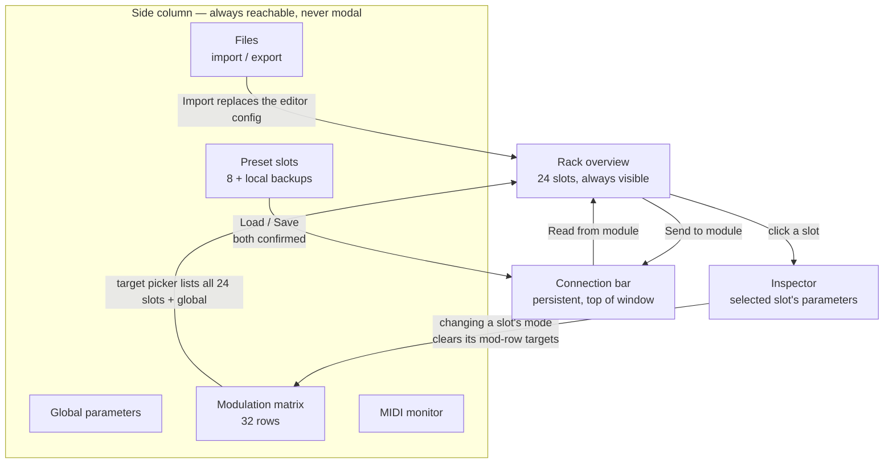
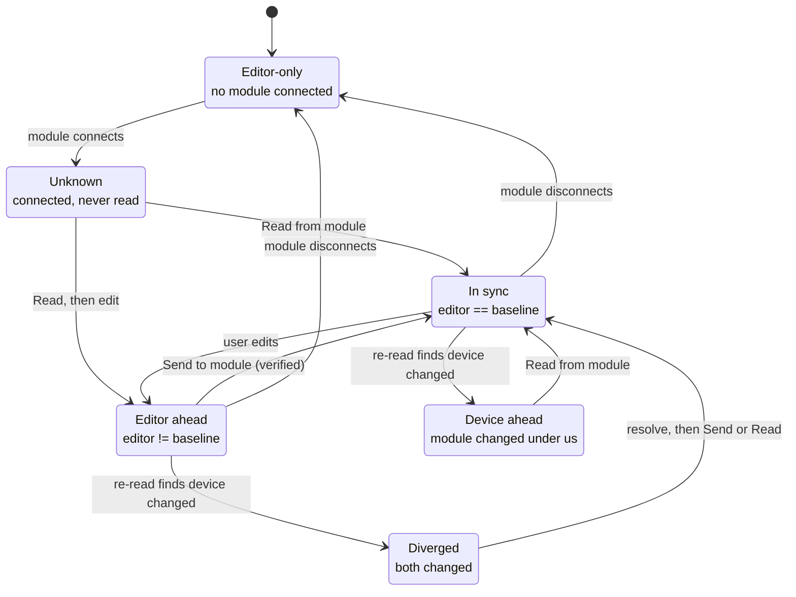
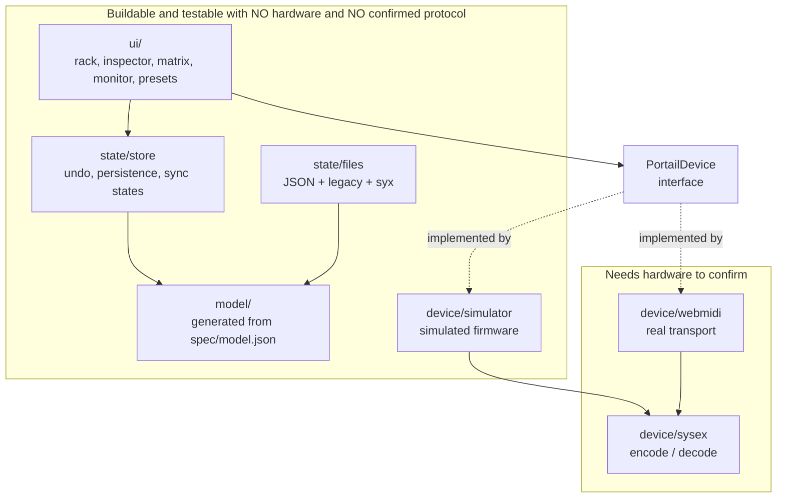
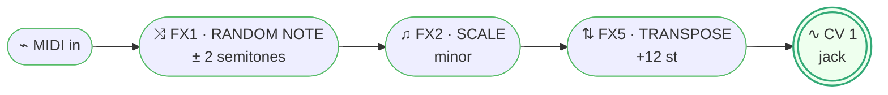

# Portail Editor — Design

A replacement for the official eowave Portail web editor at <https://www.eowave.app/portail/>.

**Read [`AUDIT.md`](AUDIT.md) first** — it establishes what the official editor does (the parity
floor) and the 22 concrete ways it fails. This document is the plan for the replacement, written to
be reviewable by someone who knows the hardware but has not seen any code.

**Status: awaiting approval.** Nothing here is settled. *(Updated during review: preset-indexing
and FX-line-width unknowns were resolved by the coordinator's firmware disassembly — see §3.7 and
§8 — and the no-brick invariant below was added at Tina's request.)*

### Ground rules this design is built on

| Rule | Source |
|---|---|
| `spec/model.json` is the only source of parameter names, ranges, defaults and units. The app never invents one. | Coordinator |
| Anything not confirmed against hardware is visibly marked unverified in the UI. | Coordinator |
| No firmware flashing. Config and presets only. | Coordinator |
| Public release: unofficial framing, MIT, static hosting, no backend. | Coordinator |
| MVP is parity + the UX fixes. No librarian, no patch diffing, no tag/search, no live-tweak mode. | Coordinator |
| **The app must be incapable of permanently bricking the module.** See the invariant below. | Tina (hard requirement) |

### Invariant zero — the opcode allowlist

Originally a brick-prevention measure; the firmware re-derivation upgraded it to **security-critical**.
Two undocumented opcodes are actively dangerous, and the app must be *incapable* of emitting them:

| Opcode | Danger |
|---|---|
| `0x16` (22) | **Out-of-bounds RAM write** — a memory-safety defect; denied. Details withheld (see `SECURITY.md`). |
| `0x1F` (31) | **Out-of-bounds RAM read** — a memory-safety defect; denied. Details withheld (see `SECURITY.md`). |
| `0x24` (36) | **Out-of-bounds RAM write** (microtonal-table writer) — a third confirmed defect; denied. Details withheld (see `SECURITY.md`). |
| `0x06` | Factory reset — confirmed to erase all 8 presets; denied. |

Enforced in the transport layer, not by convention. `spec/protocol.md` §0.9 (*Safety model*) is the
canonical statement of both lists; this section restates it as design requirements:

- **The only opcodes the app can emit are the config/preset critical path** — the line reads/writes
  (`0x00`–`0x03`, `0x08`, `0x09`), globals (`0x0A`, `0x0B`) and the individual global setters
  (`0x11`, `0x17`–`0x1A`, `0x20`), the per-row mapping pair (`0x12` 13-byte form / `0x13`), presets
  (`0x04` payload `1`–`8` only, `0x05`, `0x07`), MIDI-learn arm (`0x1D`), and the version/ping
  probes (`0x22`, `0x23`).
- Everything else is **unrepresentable in the API, not merely unused**: `0x06`, `0x0C`–`0x10`
  (calibration and file transfer), `0x14`–`0x16`, `0x1B`–`0x1C`, `0x1E`–`0x1F`, `0x24`–`0x2C`, the
  192-byte form of `0x12`, and anything above `0x2C`. The frame builder is private to the codec;
  the only exported constructors are the allowlisted messages, and the raw-SysEx import path
  filters against the same allowlist before sending.
- **The unit test asserts two things, belt and suspenders:** (1) the set of emittable opcodes is
  *exactly* the allowlist — a future contributor cannot widen it by accident — and (2) each
  named-dangerous opcode above (`0x06`, `0x16`, `0x1F`, and the full deny-set) is individually
  absent, so even a wrong edit to the allowlist constant fails the named assertions.

Why the worst case is bounded — the recovery story (this text also belongs in the README), backed by
`protocol.md` §0.9's proof that the firmware's only flash-write path targets a compile-time-constant
preset region 2 MB above the code:

1. **Config writes are volatile.** They touch working memory only; a power-cycle restores the last
   saved preset. Nothing in the critical path can persist a bad state except preset save.
2. **Preset save (`0x07`) goes through the firmware's own flash routine** — the same one the module
   uses itself, hardcoded to the preset region. Worst case is a preset containing values you didn't
   want, recoverable by rewriting the preset.
3. **Even corrupted firmware is recoverable, and not by us:** the RP2040's BOOTSEL bootloader is in
   mask ROM, which cannot be overwritten by anything — hold the button at power-up and re-drag the
   official UF2. And this app has no firmware-flashing path at all, so it cannot get that far.

### Two facts that shape everything below

1. **The module is an RP2040 running TinyUSB's USB MIDI device class.** It enumerates as a standard
   USB MIDI device, so **WebMIDI is the correct and only transport** — no WebUSB or WebSerial
   fallback is needed or wanted. It also means SysEx is carried in TinyUSB's 4-byte USB-MIDI packets
   through a fixed-size RX FIFO, which is why §3 treats bulk transfer as something that must be
   paced and verified rather than sprayed.

2. **`F0 06 29` collides with Moog Music's registered manufacturer ID** (`0x06`).
   `spec/protocol.md` §1.2. The official editor lets the user pick any MIDI port and writes to it
   blind — so a mis-selected port can write Portail configuration into a Moog. **Every write path in
   this design is gated behind a successful version handshake on that specific port.** This is the
   single highest-value protocol-level improvement available and it is non-negotiable.

---

## 1. Feature parity

Every capability of the official editor. "Replacing" means the capability survives but the
interaction changes.

### 1.1 Editing

| Official capability | Decision | Reason |
|---|---|---|
| 15 CV modes, per-mode parameter sets | **Keep** | Core function. Driven from `model.json` so it cannot drift. |
| 14 Gate (D-GATE) modes | **Keep** | Same. The app labels this output family **D-GATE** (eowave's panel term), while the mode named GATE keeps its name; internally the family key stays `gate`. |
| 16 FX types incl. post-FX wire encoding | **Keep** | Same. The `32 + (n-9)` encoding is handled at the codec boundary only. |
| 32-row modulation matrix | **Keep** | Core function. |
| Mod matrix parameter/min/max populated from the target's *current* mode | **Keep** | The one genuinely good idea in the original. Preserved exactly. |
| MIDI learn for mod rows (opcode `0x1D`) | **Keep** | Works well; only the arming UI changes. |
| 8 global parameters incl. 14-bit tempo | **Keep** | Core function. |
| Type-change defaults (`default_cv_values` etc.) | **Keep, and surface** | The original applies them invisibly. We apply them *and* show each parameter's default. |
| Per-line "update" button | **Replace** | Becomes "send this slot", explicit and separate from bulk send. See §3. |
| CV / Gate / FX / Matrix / Global tabs | **Replace** | Replaced by the single-screen rack overview. §2. |
| Per-parameter CC grid (`mem[25]`, 192 bytes) | **Drop** | Unreachable dead code in the original — `active_mapping()` is never called and references a DOM element that does not exist (AUDIT §2.17). It also collides on opcode `0x12` with the real per-row mapping and may be actively corrupting the CC map ([OQ-4](../spec/open-questions.md#oq-4)). Reimplementing a feature the vendor removed, using a message format we suspect of causing data loss, is not parity — it is a hazard. **We must never send it.** |
| Hidden FX types (`vel vca`, `maths`, `mod_lfo`, `mod_cc`, `conditional`, `modulate`) | **Drop for MVP** | Commented out of the shipped menu; may or may not exist in firmware ([OQ-12](../spec/open-questions.md#oq-12)). Advertised on eowave's product page, so worth revisiting — but shipping a control for a mode that may do nothing is exactly the "guessed value" the ground rules forbid. |

### 1.2 Device operations

| Official capability | Decision | Reason |
|---|---|---|
| Read all (24 lines + globals + 32 mod rows + version + preset) | **Keep, replace mechanism** | Same data. Fixed timers → tracked per-message replies with an explicit partial-read report. §3.5. |
| Write all | **Keep, replace mechanism** | Same. Paced, then verified by read-back, because there is no ACK (`protocol.md` §0.7). |
| Save to preset (`0x07`) | **Keep, replace interaction** | The original's "Save parameters" sits next to "save to file" with no confirmation. §3.7. |
| Load preset (`0x04`) | **Keep, replace interaction** | The original loads immediately on dropdown change, discarding unsaved edits silently (AUDIT §2.7). |
| Firmware version query (`0x22`) | **Keep, promote** | Becomes the connection gate, not a label that appears once. |
| Connection check (`0x23`) | **Keep, promote** | Becomes a heartbeat behind an honest "last verified" timestamp. §3.3. |
| Save/load `.txt` config file | **Replace** | Versioned, validated JSON (§4.3). We also *import* the original `.txt` so nobody's existing patches are stranded. |
| "Latest firmware" download button | **Drop** | Out of scope by instruction. README explains why and points at the official editor. |
| MIDI activity LED + raw byte dump | **Replace** | Becomes a decoded, filterable monitor. §2.4. |

### 1.3 Things the original does not have

| New capability | Why it is in the MVP |
|---|---|
| Offline editing with explicit sync | Non-negotiable #2. The original cannot edit without hardware at all. |
| Undo/redo across the whole config | Non-negotiable #3. |
| Working state survives reload | Non-negotiable #3. |
| All 24 slots on one screen | Non-negotiable #5. |
| Unit, range, default and explanation on every parameter | Non-negotiable #6. |
| Decoded MIDI monitor | Non-negotiable #7. |
| Preset slot manager with backup/restore | Non-negotiable #8. |
| Version-handshake write gate | The Moog collision. §0. |
| Simulator | Lets the whole UI be built and tested before the protocol is confirmed. §5.3. |

### 1.4 Deliberately not built

Listed in `README.md` under "Not yet built": patch librarian, side-by-side config diffing, tag/search
library, live-tweak performance mode. The data layer is kept clean enough that a librarian could sit
on top later (§4).

> **Judgement call — dropping the per-parameter CC grid.**
> *Rejected alternative:* reimplement it for strict parity.
> *Why rejected:* it is unreachable in the shipped original, so no user has it today; its wire format
> collides with the per-row mapping opcode; and it is the leading suspect for the mod-matrix
> corruption reported on ModWiggler. Parity with a latent data-loss bug is not a goal. If
> [OQ-4](../spec/open-questions.md#oq-4) shows the firmware ignores it, this stays dropped; if it
> shows corruption, that becomes a bug report to eowave, not a feature.

---

## 2. Information architecture

### 2.1 Shape

One screen. No tabs for the primary editing surface, because the whole complaint about the original
is that you can never see the module at once.

- **Rack overview** (main column, always visible) — all 24 slots.
- **Inspector** (main column, under the rack) — the selected slot's parameters.
- **Side column** — connection, MIDI monitor, preset slots, file actions, globals, mod matrix.

The side column is a scrolling stack of panels rather than tabs so nothing is more than a scroll
away. On narrow viewports it reflows below the main column.

### 2.2 Navigation



Everything in the side column is *always reachable*. Nothing is behind a modal except destructive
confirmations.

### 2.3 Overview ↔ detail — the rack mirrors the panel

**The overview is laid out as the hardware is laid out.** The Portail's front panel has its 16
output jacks in **two vertical columns**: 8 **CV** jacks down the left, 8 **D-GATE** jacks down the
right. (eowave's term is *D-GATE* — dynamic gate — not "gate"; the app uses that label throughout.)
The overview matches that geometry exactly: two tall columns, CV 1–8 top-to-bottom on the left,
D-GATE 1–8 top-to-bottom on the right, so a user's eye maps **screen → panel 1:1**. Output *N* is
always in the same place on screen as it is on the module.

Each output card shows:

- the output name (`CV 3`, `D-GATE 5`);
- its **mode** (`LFO`);
- a one-line summary built from its most identifying parameters (`ch 1 · rate 1/8`);
- an **FX-chain indicator** — small badges for any FX slots targeting this output, in processing
  order (§6.5), so the chain is visible from the overview, not just in detail;
- a dot when it differs from the module.

**FX slots are not outputs — they have no jacks — so they are not a third rack column.** Showing
them as peers of CV and D-GATE (as the official editor's tabs do) is the very confusion that hides
the signal chain. FX live in their own area and are shown as what they are: processors *on* an
output's path. See §6.5.

Clicking a card selects it and the inspector below shows its full parameter set **and its FX chain**.
**The rack never scrolls out of view when you edit** — selection changes the inspector in place, so
you keep the whole-module picture while working on one output. That is the entire point of the
layout.

> **Judgement call — inspector below the rack, not a side drawer or modal.**
> *Rejected alternatives:* (a) modal dialog per slot; (b) inspector in the right column.
> *Why rejected:* a modal hides the overview, which defeats the purpose. The right column is only
> 360 px and several modes have 8 parameters with long labels — it would force two-line wrapping on
> every field. Below the rack, the inspector gets full width, lays parameters out in a multi-column
> grid, and has room for the horizontal FX-chain strip (§6.5).

### 2.4 Where each thing lives, and why

| Panel | Location | Reasoning |
|---|---|---|
| Connection + sync state | Persistent bar under the masthead | It must be answerable at a glance, always. Never scrolls away. |
| Rack overview | Main column, top | Primary view. Two vertical columns (CV \| D-GATE) mirroring the panel geometry (§2.3). |
| Inspector | Main column, below rack | Needs width; must not occlude the rack. Hosts the selected output's FX-chain strip. |
| FX signal flow | Inspector strip + dedicated view | The chain lives where the output it feeds is edited, and in a whole-module flow view (§6.5). |
| Globals | Side column | Set rarely, consulted occasionally. |
| Mod matrix | Side column, full-width overflow | 32 rows × 6 controls; scrolls horizontally within its panel rather than widening the page. |
| Preset slots | Side column | Consulted at session start and end. |
| MIDI monitor | Side column | Diagnostic — wanted *while* doing something else, so it must not be a separate screen. |
| Module LED guide | Side column | Always-available legend decoding the panel's real (undocumented) LED behaviour (§6.6). |
| Files | Side column | Session start/end. |

---

## 3. The sync model

This is the part the official editor gets worst and the part most worth getting right. The governing
rule: **the user must never have to guess whether what they see is on the module.**

### 3.1 What actually makes this hard

Three protocol facts, all confirmed in `spec/protocol.md`:

1. **No write acknowledgement.** `output.send()` returns; nothing comes back. The only way to know a
   write landed is to read it back (§0.7).
2. **No change notification.** The module never tells us anything. If someone recalls a preset from
   the front panel, we cannot know. There is no revision counter to poll.
3. **No checksum.** A short or corrupted read is undetectable except by length and range validation.

The honest consequence: **we can never claim the editor and the module match *right now*.** We can
only claim they matched at the moment we last verified. Every design decision below follows from
refusing to pretend otherwise.

> **Judgement call — showing "last verified at T" instead of a live in-sync indicator.**
> *Rejected alternative:* poll the module continuously and show a live green "in sync" light.
> *Why rejected:* a full verify is 59 exchanges; polling that continuously would saturate the link
> and interfere with playing. Polling something cheaper (the ping) proves the module is *alive*, not
> that its contents match. A green light that means "alive, and matched four minutes ago" is exactly
> the kind of confident-but-wrong indicator this project exists to eliminate. We show liveness and
> match-age as two separate, honestly-labelled facts.

### 3.2 The three-way model

Git's model, because the problem is git's problem. Three snapshots:

| Snapshot | Meaning |
|---|---|
| `editor` | What you are editing. The only thing your edits touch. |
| `baseline` | The module's contents **as of our last successful full read**. Plus the timestamp of that read. |
| `device` | The module's actual contents *now*. **Unobservable without a read.** |

`baseline` is our belief; `device` is the truth. A read updates both `baseline` and our knowledge of
`device`. Comparing `editor` against `baseline` gives the five states.

### 3.3 The five states



| State | Condition | Indicator | What the user is told |
|---|---|---|---|
| **Editor-only** | No connected module | Grey pill, "Offline — editing only" | "No module connected. You can edit, import and export; sending is unavailable." |
| **Unknown** | Connected, no successful read this session | Grey pill, "Module contents unknown" | "Connected, but we haven't read this module yet, so we can't tell you whether it matches." Offers **Read from module**. |
| **In sync** | `editor == baseline` | Green pill, "Matched module · verified 2 min ago" | The age is always shown. It is never just "in sync". |
| **Editor ahead** | `editor != baseline` | Amber pill, "Not sent: 3 slots, globals" | Names exactly what differs, by slot. Rack cards carry a dot. |
| **Device ahead** | Re-read shows `device != baseline`, `editor == baseline` | Blue pill, "Module changed — 2 slots differ" | "The module's configuration changed since we last read it. Someone may have recalled a preset on the module." |
| **Diverged** | `device != baseline` **and** `editor != baseline` | Red pill, "Conflict — both changed" | Full conflict flow, §3.6. |

Device-ahead and diverged are only ever discovered by an explicit read or verify — never claimed
speculatively.

### 3.4 The two explicit actions

There are exactly two buttons that move data, they are always visibly labelled by direction, and
neither ever fires as a side effect of editing.

**Read from module** — module → editor.
1. Requires a connected, handshake-confirmed port.
2. If `editor != baseline`, confirm first: *"The editor has unsent changes. Reading replaces them with the module's configuration. Export a copy first?"* with **Export then read / Read anyway / Cancel**.
3. Issues 59 requests (24 lines + globals + 32 mod rows = 57, plus the version and active-preset
   queries), each with its own reply matcher and timeout.
4. Sets `editor` and `baseline` to the result; stamps the verify time.
5. If any request went unanswered, the result is reported as **partial**, naming exactly which lines
   are missing, and `baseline` is *not* updated — a partial picture is not a baseline.

**Send to module** — editor → module.
1. Requires a connected, handshake-confirmed port.
2. Shows what is about to change (count of slots + whether globals/matrix are included).
3. Writes 57 messages (24 lines + globals + 32 mod rows), paced (§3.8).
4. **Immediately reads back and compares.** This is the only integrity check the protocol permits.
5. On match: state becomes in-sync, verify time stamped. On mismatch: reports exactly which lines
   did not take, and offers a retry of just those lines.
6. **Writes to working memory only.** It does not touch preset flash. The UI says so on the button's
   tooltip and in the confirmation.

There is deliberately **no auto-send**, and no per-keystroke transmission. §1.1 keeps a per-slot
"send this slot" action for iterating on one output, but it is a distinct, labelled button in the
inspector — never implicit.

### 3.5 Partial transfers

The original sprays 56 messages on fixed timers and reports nothing (AUDIT §2.14). Here every
request carries a reply matcher keyed to its opcode *and* its line index, with a timeout. The result
of a read is:

```
{ config, partial: boolean, missing: string[] }   // e.g. missing: ["GATE 4", "mod row 17"]
```

A partial read is surfaced as a warning naming the missing lines, does not become the baseline, and
offers a retry. A partial *write* is detected by the verify step in §3.4 and offers a targeted retry.

### 3.6 Conflict

Reached when a verify finds `device != baseline` while `editor != baseline`. The dialog offers three
outcomes and no default:

| Choice | Effect |
|---|---|
| **Keep my edits** | Send editor → module, overwriting the module. |
| **Take the module's version** | Replace editor with the module's config. Undoable, since it goes through the undo stack. |
| **Cancel** | Change nothing. Both remain as they are; the conflict pill stays until resolved. |

The dialog always offers **Export my version first**, because "take the module's version" is the one
path that can lose work the user cannot get back. (It is undoable in-session; export protects
against closing the tab.)

> **Judgement call — no automatic merge.**
> *Rejected alternative:* merge non-overlapping slot changes automatically.
> *Why rejected:* the config is not independent per slot. FX slots target outputs, mod rows target
> slot parameters, and voice-mode poly groups span outputs. A "non-overlapping" merge can produce a
> configuration neither side intended — e.g. an FX pointing at a slot whose mode changed. Whole-config
> choice is comprehensible; a silent merge is not.

### 3.7 Presets — the destructive path

`spec/protocol.md` §0.5 establishes three constraints that make presets much sharper than they look:

- Save (`0x07`) **always targets the currently active preset**. There is no "save to slot N".
- Therefore saving to slot N is: **recall N → re-send the whole config → save**. And recall
  *discards unsaved live edits on the module*.
- There is no enumerate opcode and **no preset name storage on the device at all**.

So the flows are:

**Load preset N** — confirmed if the editor has unsent changes. Sends recall, then performs a full
read (a recall changes the module's live memory, so our baseline is stale the instant it happens).

**Save to preset N** — a three-step sequence, and the confirmation says so explicitly:
> "This will make slot N active on the module, write your configuration to it, and store it
> permanently. Slot N's current contents will be replaced. This cannot be undone from the editor."

Then: recall N → send our full config from our own in-memory copy (never trusting what recall left
in the module) → `0x07` → read back and verify.

**Back up all slots** — the only way to enumerate is brute force: for each of the 8 slots, recall and
full-read. That is 8 × 59 exchanges and it *leaves a different preset active than when it started*.
So it is an explicit, progress-indicated action that: records the originally-active slot, walks all
8, restores the original slot at the end, and tells the user it did. Never automatic on connect.

**Preset names are stored in this browser and in exported files, never on the module.** The UI says
so where the names are edited, because a user will otherwise reasonably expect names to travel with
the hardware.

> **[OQ-1](../spec/open-questions.md#oq-1) is now resolved** — by the coordinator's firmware
> disassembly, recorded in `spec/protocol.md` §0.5. The wire protocol is genuinely asymmetric:
> **recall takes 1–8, the active-preset query returns 0–7**, and the official editor handles both
> correctly (the "off-by-one bug" this document previously inferred from its JavaScript was wrong).
> Two edge cases the app must honour: sending `0` recalls **preset 8** (`(0−1) & 7`), and `9`–`127`
> are silently ignored. The conversion lives in exactly one function, with the `0` case excluded by
> construction.
>
> *Caveat:* the resolution is a single-pass disassembly, currently being adversarially re-checked,
> and not yet confirmed on hardware. The preset UI is built to it, but hardware confirmation stays
> on the §8 register until recorded in `open-questions.md`.

### 3.8 Pacing

The original uses a fixed 5 ms gap with overlapping volleys and no basis for the number. The real
minimum is unknown ([OQ-6](../spec/open-questions.md#oq-6)). Given TinyUSB's fixed RX FIFO, the
design is:

- Reads are **request/reply**, so they are self-pacing — the next request goes out when the previous
  reply arrives or times out. This is inherently safe regardless of the answer to OQ-6.
- Writes have no reply, so they use a conservative fixed gap (8 ms) **plus the mandatory read-back
  verify**, which converts an unknown-safe-rate problem into a detectable one.
- The gap is a single named constant so OQ-6's answer is a one-line change.

---

## 4. Data model

### 4.1 Derivation from the spec

`spec/model.json` is canonical. A build step (`npm run sync-spec`) adapts it into the shape the app
consumes and **fails the build if the spec is absent** — the app must never fall back to an invented
model. The adapter:

1. normalises the spec's `snake_case` into the app's shape;
2. computes each parameter's **7-bit ceiling** (`wireMax = min(spec.max, 127)`), independently
   reproducing the spec's four overflow warnings;
3. attaches prose descriptions, tagged with provenance;
4. passes through the spec's `led_colors` block verbatim — the firmware's status palette, consumed
   only by the Module LED guide (§6.6), never used to tint output cards by mode (§6.2);
5. passes through each mode/FX `icon` id (§6.0-B) when present, falling back to a placeholder keyed
   off the mode `key`, and reports which entries still lack a real icon;
6. reports anything undescribed.

The editor **mode-family palette** (§6.2, used for output-jack tints) is an editor convention, not a
hardware fact. Its grouping and colours are shared with the manual via a proposed `family` field and
`mode_families` block in `model.json` (§6.2); the adapter reads them from there when present, or from
the app's own palette module if the coordinator keeps `model.json` firmware-only. Either way there is
one source, versioned with whichever file owns it.

Prose provenance is the mechanism for the "never ship a guessed value" rule:

```ts
docSource: 'spec' | 'editor-derived'
```

`'spec'` means the canonical model states it. `'editor-derived'` means *we* wrote it by reading the
official editor's source, and it is **rendered in the UI with a visible "unverified" tag**. When the
coordinator adds descriptions to the spec, they win automatically and the tag disappears.

### 4.2 In-memory types

```ts
/** One of the 24 configurable slots. Byte 0 mirrors the mode.
 *  Width is per-family: CV and Gate lines are 9 bytes, FX lines are 8 — the device stores only 8
 *  on an FX write (the official editor's 9th byte is inert) and its FX read reply is 14 bytes
 *  total, not 15 (confirmed from firmware — spec/protocol.md §2.1). */
interface Line {
  mode: number;      // mode *index*, never the wire value
  bytes: number[];   // [mode, p1..] — 9 for CV/Gate, 8 for FX
}

interface ModRow {
  statusHigh: number;   // 9 = note, 11 = CC, 0 = unassigned
  channel: number;      // 0-15
  number: number;       // CC or note number
  targetLine: number;   // 0-24, or 127 = unassigned
  targetParam: number;  // byte index within the target line; 0 = unused
  valueMin: number;
  valueMax: number;
}

interface PortailConfig {
  configVersion: number;
  name: string;          // editor-side only; never sent to the module
  lines: Line[];         // exactly 24
  globals: number[];     // exactly 8 raw bytes, as line 24 is stored
  modMatrix: ModRow[];   // exactly 32
}
```

Two decisions worth stating:

**Mode index, not wire value, everywhere above the codec.** The post-FX encoding
(`wire = 32 + (index - 9)` for FX 9–15) exists in exactly one place: `sysex.ts`. Nothing else in the
app knows about it. Same for the gate `& 0x0F` mask.

**Globals stay as 8 raw bytes.** Tempo is the only 14-bit value (bytes 2–3); it is presented as one
BPM control and split at the boundary. Keeping the raw array means a byte we don't yet understand
survives a round-trip instead of being silently zeroed — which matters directly for
[OQ-2](../spec/open-questions.md#oq-2).

### 4.3 On-disk format

Portable JSON, human-diffable, versioned:

```json
{
  "kind": "eowave-portail-config",
  "configVersion": 1,
  "specVersion": "1.0.0",
  "name": "Poly pair + euclidean",
  "savedAt": "2026-08-26T13:00:00.000Z",
  "generator": "portail-editor (unofficial)",
  "lines": [
    {
      "line": 0,
      "label": "CV 1",
      "mode": "NOTE",
      "modeIndex": 1,
      "params": { "channel": 0, "voice_mode": 3, "bend_range": 1, "note_high": 127 },
      "bytes": [1, 0, 3, 1, 0, 0, 0, 0, 127]
    }
  ],
  "globals": [0, 0, 0, 120, 0, 0, 16, 0],
  "modMatrix": [ /* 32 rows */ ]
}
```

Names *and* numbers are both written. `bytes` is authoritative on import; `params` and `mode` exist
so a patch is readable in a text editor and reviewable in a pull request — which is what makes
patches shareable, per non-negotiable #4.

**Migration.** `configVersion` is checked on import. Version 1 is the only version; a file from a
future version is **refused with an explanatory message**, not best-effort parsed. When a breaking
change arrives, the loader gains a chain of `migrate_N_to_N+1` functions applied in sequence, and the
refusal message becomes "this file is newer than this editor — update the editor". `specVersion` is
recorded but advisory: it tells a reader which model the patch was authored against.

**Validation on import is total.** Line count, byte count per line, every byte in `0..127`, and every
mode index checked against the model. A bad file is rejected with a specific reason
(`"Line 9 (GATE 2) uses mode 14, which this editor does not know"`), never silently applied. This is
the direct fix for AUDIT §2.15.

**Legacy import.** The official editor's `output.txt` is also importable — same validation, plus
decoding of the FX wire byte and the gate mask. Export is JSON only; we do not write the legacy
format back.

**Raw SysEx.** `.syx` export (the exact bytes a full send would transmit) and import are supported
for interoperability and for people who want to send a patch with SysEx Librarian. Import decodes
the messages into a config and never relays them verbatim — a `.syx` file is data, not a way past
invariant zero's allowlist.

### 4.4 Mapping to the device

| Config field | Device |
|---|---|
| `lines[0..7]` | CV outputs 1–8 — opcodes `0x02` read / `0x03` write |
| `lines[8..15]` | D-GATE outputs 1–8 (family key `gate`) — `0x00` / `0x01` |
| `lines[16..23]` | FX slots 1–8 — `0x08` / `0x09` |
| `globals` | Line 24 — `0x0B` read / `0x0A` write |
| `modMatrix[0..31]` | `0x13` read / `0x12` write |
| `name` | **Nowhere.** No storage exists on the module. |

### 4.5 Room for a librarian later

`PortailConfig` is a plain serialisable value with no device coupling, and the store already keeps a
map of slot → config for preset backups. A librarian would be a new module holding
`{ id, config, tags, savedAt }[]` in IndexedDB plus a browse UI — no change to the types above. That
is why it is cheap to defer.

---

## 5. Module boundaries



### 5.1 `PortailDevice`

The seam. Both implementations satisfy it, so the UI never knows which it is talking to.

```ts
interface PortailDevice {
  readonly kind: 'webmidi' | 'simulator';

  start(): Promise<void>;
  stop(): void;

  getState(): ConnectionState;
  listPorts(): PortInfo[];
  selectPort(id: string): Promise<void>;
  probe(): Promise<void>;                   // version handshake — the write gate

  readConfig(): Promise<ReadResult>;        // { config, partial, missing[] }
  writeConfig(c: PortailConfig): Promise<void>;
  writeLine(line: number, c: PortailConfig): Promise<void>;

  savePreset(slot: number): Promise<void>;  // recall → write → save (§3.7)
  loadPreset(slot: number): Promise<void>;
  getCurrentPreset(): Promise<number | null>;

  setLearnMode(on: boolean): Promise<void>;
  sendRaw(messages: Uint8Array[]): Promise<void>;

  on<K>(event: K, fn: Handler<K>): () => void;  // connection | activity | progress | preset | learn
}
```

`ConnectionState` is a discriminated union covering `unsupported | requesting | denied | searching |
connected | lost | error`, each carrying the reason to display. There is no boolean `isConnected`,
because a boolean is how the original ends up with nothing to say when things go wrong.

### 5.2 Encode/decode

`device/sysex.ts` is pure functions over bytes: no DOM, no MIDI, no state. It owns the post-FX
encoding, the gate mask, the 7-bit clamp, the request/reply length disambiguation, and `.syx`
blob splitting. **This is where the unit tests go** (Vitest), because it is the layer where a bug is
silent and expensive. Firmware-confirmed codec facts the tests pin down: FX writes carry 8 bytes
and FX read replies are **14 bytes total** (test vectors match, never 15); and firmware masks FX
byte 1 (the target) with `& 7`, so the codec applies the same clamp on encode to keep round-trips
faithful. Target coverage: every mode's round-trip, both wire-encoding quirks, per-family line
width, the FX target mask, clamping, malformed input, echo rejection, and the invariant-zero
assertions — emittable set exactly equals the allowlist, **and** each named-dangerous opcode
(`0x06`, `0x16`, `0x1F`, full deny-set) is individually absent.

### 5.3 The simulator

Not a stub. It keeps its own working memory and 8 preset slots, parses the same SysEx we would send
to hardware, and replies with the same SysEx we believe hardware sends. It also models the things
that make the real transport risky — configurable packet-drop rate and latency, and **no write
acknowledgement** — so the partial-transfer and verify paths in §3.5 are genuinely exercised rather
than assumed.

Consequence: the entire UI, the whole sync model, presets, undo, import/export and the monitor can be
built and demonstrated before a single byte reaches a module. Only §5's `hw` box needs the hardware.

### 5.4 State store

Plain observable store, no framework. Owns `editor`, `baseline`, undo/redo stacks, localStorage
persistence (debounced), preset metadata and toasts. Every mutation goes through `commit(label, fn)`,
which is what makes undo total rather than per-widget.

> **Judgement call — no framework.**
> *Rejected alternative:* React or Svelte.
> *Why rejected:* the brief asks for justification before adding one. The app is one screen with a
> handful of panels and a single store; the total UI logic is small. A framework would add a build
> dependency, a bundle, and an idiom, to solve a re-render problem that a scheduled full-panel
> re-render with focus preservation already solves. *Cost accepted:* we hand-roll focus restoration
> around re-renders, which is the one place this choice hurts. If the UI grows a second screen with
> shared interactive state, this is worth revisiting — and the store/UI split is drawn so that it
> could be.

---

## 6. Visual design

### 6.0 Two representation principles (design law)

These are load-bearing, not styling. Both follow Bret Victor's *make the invisible visible*: the
Portail's structure is real but has no on-screen form until we give it one, and the form must carry
the meaning rather than decorate it. Everything else in §6 obeys these two rules.

#### Principle A — shape encodes ontology: physical is a circle, abstract is a lozenge

There are two kinds of thing in a Portail patch, and the interface must make the boundary between
them legible without reading a word:

- **A physical output** — a jack you actually patch a cable into — is drawn as a **circle**: a ring
  with a socket at its centre, tinted by its **mode-family** colour (§6.2). Its *shape* mirrors the
  panel jack; its *colour* is an editor mode-family convention, not the panel's LED colour (§6.2).
  Abstract lozenges (FX, source) stay **neutral grey** — cable colour is reserved for outputs.
- **An abstract node** — an FX processor, the MIDI source, a CC channel, a clock — has no jack and is
  drawn as a **lozenge/pill**.

The rule is absolute: **never draw an output as a lozenge, never draw an FX or source as a circle.**
The payoff is that the signal-flow view (§6.5) reads physically at a glance — abstract, abstract,
then *physical*: `MIDI ⬭ → FX ⬭ → ◯ jack`. The eye sees "processing that finally reaches a socket"
without parsing labels, because the terminal circle is unmistakably a place a cable goes and the
lozenges before it are unmistakably not. This is the same distinction the hardware makes in metal
(there are 16 sockets and nothing else is a socket); the editor honours it in pixels.

*Component consequence.* This is enforced by having two distinct primitives, not one styled two ways:

| Primitive | Represents | Form |
|---|---|---|
| `<OutputJack>` | one of the 16 CV / D-GATE outputs | circle: ring tinted by mode **family** (§6.2) + socket dot, mode icon, name |
| `<FxChip>` | an FX processor, or a source/CC/clock node | lozenge: **neutral grey** pill outline, FX icon, name — never a family colour (§6.2) |

A rack card embeds an `<OutputJack>`; an FX badge and every node in the signal-flow view is an
`<FxChip>`. Because they are separate components, the ontology cannot drift — there is no `variant`
prop that could accidentally render an output as a pill.

#### Principle B — every mode and FX carries an icon, not just a name

A bare capitalised name (`NOTE`, `VELOCITY`, `SCALE`, `DELAY`, `EUCLIDEAN`…) is a word you must
*read*; an icon+name pair is a shape you can *recognise*. With up to 45 distinct modes on screen at
once, recognition speed is the difference between scanning and hunting. So **every mode and FX gets a
small icon**, shown beside its name everywhere it appears — rack cards, the mode dropdown, FX chips,
the signal-flow view, and the manual.

Icon set spec:

- **One icon per mode/FX**: the 15 CV modes, 14 D-GATE modes, 16 FX — a fixed, shared vocabulary.
- **Stroke-based, drawn on a 16 px grid, one consistent visual style** (uniform stroke width, round
  caps/joins, no fills).
- **Inline SVG using `stroke="currentColor"`**, so each icon inherits the LED/mode tint of whatever
  it sits in — an icon in a green LFO card is green, the same glyph in the dropdown is text-coloured.
  No icon carries its own colour; colour always comes from context (which keeps §6.2's colour rule
  intact and makes the set theme-proof).
- Icons are **recognition aids, never the sole signifier** — the name is always present too, so the
  set stays accessible and survives a missing glyph.

*One vocabulary for app and manual.* The icon identity must live in the shared model, not be
hard-coded twice. **Proposed spec change (coordinator owns `spec/model.json`, so this is a request,
not an edit): add an `icon` string field to each mode and FX entry** — e.g. `"icon": "lfo"` — naming
its glyph in a single icon registry the app ships and the manual references. That way the editor and
the manual cannot show different icons for the same mode. The build adapter (§4.1) passes `icon`
through when present. Until the field and the real artwork exist, the app renders **simple drawn
placeholders keyed off the mode `key`**, so no screen is blocked on the asset hand-off; the user is
sourcing the reference set and will supply final glyphs.

> **Judgement call — a shared `icon` field in the model rather than an app-only icon map.**
> *Rejected alternative:* keep an icon lookup table inside the app, keyed by mode key.
> *Why rejected:* the manual (owned by another agent) needs the *same* icons, and two independent
> lookup tables guarantee eventual drift — the app and the manual showing different glyphs for
> `SCALE` is exactly the kind of split this project exists to prevent. One `icon` field in the
> canonical model is the single source both consume. *Cost:* a coordinated change to a file this
> agent doesn't own — hence proposed, not made.

### 6.1 Overview screen

The two output columns mirror the panel: CV down the left, D-GATE down the right, output *N* in the
same place on screen as on the hardware. Each output is a circular `<OutputJack>` (§6.0-A) whose ring
takes its **mode-family** colour (§6.2 — an editor convention, not the panel's LED colour), with the
mode's icon (§6.0-B) beside its name. The selected output's FX chain appears as a horizontal strip of
**neutral-grey** lozenge chips in the inspector (§6.5).

```
┌────────────────────────────────────────────────────────────────────────────────────┐
│ Portail Editor  [UNOFFICIAL]                                   [◐ theme]  [?]        │
├────────────────────────────────────────────────────────────────────────────────────┤
│ ● Portail connected · Portail · firmware 0.9a         ⬤ Matched module · 2 min ago  │
│                                       [Read from module] [Send to module] [Simulator]│
├───────────────────────────────────────────────────────┬────────────────────────────┤
│ MODULE OVERVIEW                     11 of 24 slots used│ MIDI ACTIVITY        ● in 42│
│  ┌── panel geometry: CV left, D-GATE right ──┐         │ ☑Notes ☑CC ☐Clock ☑SysEx    │
│      CV · 16-bit            D-GATE · 12-bit            │ ┌────────────────────────┐  │
│  ┌───────────────┐      ┌───────────────┐             │ │← ch1 note on C3 vel 100│  │
│  │◯ CV1  ♪NOTE  ▸fx│    │D-GATE 1  GATE   │           │ │← ch1 CC 1 (mod wheel)=64│  │
│  │ch1 · poly 1     │    │ch1 · ← CV 1     │           │ │→     CV 1 line config  │  │
│  ├───────────────┤      ├───────────────┤             │ └────────────────────────┘  │
│  │◯ CV2  ♪NOTE  ▸fx│    │D-GATE 2  GATE   │           ├────────────────────────────┤
│  │ch1 · poly 1     │    │ch1 · ← CV 2     │           │ PRESET SLOTS      3/8 backed│
│  ├───────────────┤      ├───────────────┤             │ 1 [Live set      ] [Ld][Sv] │
│  │◯ CV3  ▮VEL      │    │D-GATE 3  CLOCK  │           │ 2 [Drums         ] [Ld][Sv] │
│  │ch1              │    │1/8 · 5V         │           │ ...                         │
│  ├───────────────┤      ├───────────────┤             ├────────────────────────────┤
│  │◯ CV4 ●∿LFO      │    │D-GATE 4  EUCLID │           │ GLOBAL PARAMETERS           │
│  │ch1 · 1/8        │    │15/3 · 1/8       │           │ Clock run   [stop      ▾]   │
│  ├───────────────┤      ├───────────────┤             │ Tempo BPM   [120]           │
│  │CV 5   —off—     │    │D-GATE 5  —off—  │           │   range 30…250 · default 120│
│  │                 │    │                 │           ├────────────────────────────┤
│  ├───────────────┤      ├───────────────┤             │ MODULATION MATRIX  3/32 rows│
│  │CV 6   —off—     │    │D-GATE 6  —off—  │           │ 1 [CH1 CC74][CV 4][rate][…] │
│  │  … CV 7, CV 8 … │    │ … D-GATE 7, 8 … │           ├────────────────────────────┤
│  └───────────────┘      └───────────────┘             │ FILES                       │
│                                                       │ [Export JSON] [Import…]     │
│                                                       │ [Export .syx]               │
├───────────────────────────────────────────────────────┤                             │
│ CV 4                                          line 3  │                             │
│ Mode [LFO ▾]  Clock-synced LFO. A note on the channel…│                             │
│                                                       │                             │
│ SIGNAL FLOW    ⬭ ⌁MIDI ─▶ ⬭ ∿LFO ─────────▶ ◯ CV 4    │  (no FX on CV 4)            │
│                                                       │                             │
│ ┌────────────┐┌────────────┐┌────────────┐            │                             │
│ │MIDI channel││Waveform    ││Rate        │            │                             │
│ │[ch 1     ▾]││[triangle ▾]││[1/8      ▾]│            │                             │
│ │range ch1…16││range saw…  ││range 32/1… │            │                             │
│ │default ch 1││default saw ││default 4/1 │            │                             │
│ │⚠ unverified││            ││            │            │                             │
│ │MIDI channel││LFO shape.  ││Rate, a     │            │                             │
│ │this slot…  ││            ││division of…│            │                             │
│ └────────────┘└────────────┘└────────────┘            │                             │
└───────────────────────────────────────────────────────┴────────────────────────────┘
```

Each card leads with a `◯` — the circular `<OutputJack>` from §6.0-A, its ring tinted by the output's
**mode-family** colour in the running app (Pitch red, Modulation purple, Gate/Trigger yellow, …; an
editor convention, not the panel's LEDs — §6.2) — and a mode **icon** before the mode name (the ASCII `♪ ∿ ▮ ⊓ ⎍ ⋮` stand in for the real stroke icons
of §6.0-B). The `●` on CV 4 is the "differs from module" dot; `▸fx` on CV 1/CV 2 marks outputs that
have an FX chain (expanded in §6.5). The `⚠ unverified` tag under a parameter is the provenance marker
from §4.1. `← CV 1` on a D-GATE card shows a gate linked to a CV voice — a real cross-output
relationship the overview surfaces rather than hides.

### 6.2 Readability, and two separate colour systems

The problem with 16 cards in two tall columns is that they turn into wallpaper. Four devices keep
them scannable:

1. **Cards are tinted by MODE FAMILY — an editor convention, not a claim about the panel.** Each
   output card's ring takes a colour from a stable **mode-family palette defined in the app** (the
   six families below), so a Pitch output reads differently from a Modulation one at a glance. This
   is an editor aid and the UI says so; it is **not** what the hardware LED shows (see the correction
   below). Colour never carries meaning alone — the mode name and its icon (§6.0-B) are always beside
   it — so it survives colour-blindness and greyscale.
2. **CV vs D-GATE is carried by POSITION, not colour.** The two columns and their headings
   distinguish the families; colour is therefore free to encode *mode*.
3. **Unused outputs recede.** Outputs set to OFF drop to ~62% opacity. In a typical patch more than
   half are off, so the used ones pop without extra decoration.
4. **Three-line hierarchy per card**: name (small, bold), mode (largest — the thing you scan for),
   summary (small, monospace, dimmed). The eye lands on the mode row.

Each column is a vertical stack; the two columns sit side by side on desktop and **collapse to one
column (CV then D-GATE) below ~720 px**, never scrolling horizontally. The one-column fallback keeps
output *N*'s screen order intact so the panel mapping degrades predictably.

#### The correction: the hardware has no per-mode colour

An earlier revision of this design had the cards "consume the hardware's per-output LED colours" so
screen and panel would agree on a per-mode colour. **The firmware disproves that premise**
(`spec/led-colors.md`, `spec/model.json → led_colors`, both from the v0.83r disassembly): the
Portail's LEDs are a **level-and-state display, not a mode indicator**. Each LED's *brightness* is
the output's live level (VU-style) and its *colour* is the module's current **state** (idle, preset
recalled, activity, MIDI-learn) — the output's mode sets nothing. There is no per-mode colour to
match, so colouring cards by mode "to match the panel" would invent a language the hardware does not
speak.

So the design now runs **two clearly-labelled, independent colour systems**:

| System | Where | Source | Meaning |
|---|---|---|---|
| **Editor mode-family palette** | output-jack ring tint (six families, below) | **defined in the app**, independent of `led_colors` | which *mode family* an output is in — an editor convenience. FX chips are **not** tinted by it (they are neutral grey). |
| **Hardware status palette** | the Module LED guide (§6.6), and any status echoes | **`spec/model.json → led_colors`** verbatim | what the module's own LEDs are actually doing |

They must not be conflated. The mode palette is ours and is presented as such; the status palette is
the firmware's and is only ever used to *decode* real LED behaviour, never to recolour the editor's
own chrome by mode.

> **Judgement call — an app-defined mode palette, plus a separate guide to the real LEDs.**
> *Rejected alternative:* the previous plan to reuse the hardware LED colours as card tints.
> *Why rejected:* it rested on a mode→colour mapping that the firmware shows does not exist. Reusing
> a *state/level* palette as a *mode* palette would be actively misleading — it would tell the user
> "this colour means LFO" when on the panel that same colour means "this output is at this level in
> this state". The honest split is: pick our own mode palette and label it an editor aid, and decode
> the hardware's real palette in a dedicated guide (§6.6). *Cost:* two colour systems to keep
> visually distinct — mitigated by never using the hardware palette anywhere the mode palette lives.

#### The editor mode-family palette (finalised)

Six families group the 45 modes; each output-jack ring is tinted by the family of its current mode.
This is the authoritative mode → colour source for jack tinting.

| Family | Modes | Colour | Hex |
|---|---|---|---|
| **Pitch** | NOTE, ARP, SEQ | intense red | `#ff3b3b` |
| **Expression** | VEL, AT, POLY AT, PB, CC, CC RECORDER | intense purple | `#a533ff` |
| **Modulation** | LFO, ENV, RANDOM | purple | `#8360c4` |
| **Gate / Trigger** | GATE, TRIG, EUCLIDEAN | yellow | `#d0b24a` |
| **Clock** | CLOCK | intense yellow | `#ffcf1a` |
| **OFF** | OFF | grey, unlit ring | — |

Notes that make this a system rather than a colour list:

- **The hues borrow the user's Befaco / Banananuts patch-cable domains** — red = pitch / audio
  destination, purple = CV, yellow = gate/trig — so the screen speaks the colour language already in
  the rack. **Intensity then splits families that share a hue**: Gate/Trigger is a muted yellow while
  Clock is vivid; Modulation is a muted purple while Expression is vivid. Same domain, different job,
  told apart by saturation.
- **Jack colour = mode family; column position = CV vs D-GATE.** The two axes are independent and
  non-redundant — colour never re-encodes what the column already says, so each pixel of colour is
  spent on the mode family, which the layout does *not* otherwise show.
- ARP and SEQ live under **Pitch** (they output pitch); there is no separate "Sequence" family.
- **This palette is the source of truth for jack tinting** and is shared with the manual (see the
  spec proposal below); the earlier ad-hoc per-family idea is superseded by exactly these values.

**FX chips are neutral grey — never a family colour.** Purple is now a CV mode family (Modulation /
Expression), so tinting FX purple, as an earlier sketch implied, would collide with it. FX carry
their identity through their **icon**, not colour; their four sub-groups (Pitch, Filter & Logic,
Timing, Level) are distinguished by icon shape only, keeping the cable-colour vocabulary reserved for
outputs.

**Where this palette lives — one source for app and manual.** The family grouping and its colours
must not be transcribed twice. **Proposed spec change (coordinator owns `spec/model.json`, so this is
a request, not an edit): add a `family` string field to each mode entry, and a `mode_families` block
mapping `family → { label, colour, members }`.** That is the same shape as the `icon` proposal
(§6.0-B) and puts the one vocabulary both the editor and the manual consume in the canonical model.
If the coordinator would rather keep `model.json` firmware-and-editor-extracted only, the app's
palette module owns these hex values and the manual imports from there instead — **either way there
is a single source**, and the build adapter (§4.1) reads `family`/`mode_families` from wherever it
is defined. My recommendation is `model.json`, for consistency with `icon` and `led_colors` already
living there.

### 6.3 Palette

Dark-first, because this is studio software, but built the theme-correct way: the **light palette is
defined on bare `:root`**, dark is applied under `@media (prefers-color-scheme: dark)` guarded by
`:root:not([data-theme="light"])`, and both are redefined under explicit `[data-theme]` so a manual
toggle wins in either direction. No colour is ever defined *only* inside a media query.

Dim-studio specifics, all reacting to AUDIT §2.19:

- Background is `#14161a`, not `#000`. Pure black against a bright OLED panel in a dark room causes
  halation around text; a near-black grey does not.
- Body text `#e8eaee` on that background is ~13:1 — well past WCAG AA, comfortable at low
  brightness.
- Semantic colours (`ok` / `warn` / `danger`) are defined per theme so contrast holds in both.
- Accent blue `#5b9dff` in dark, `#0b62d6` in light.
- Focus rings are a 2 px accent outline with offset, on everything.

### 6.4 Accessibility

Every fix here is a direct response to AUDIT §2.18: real `<button>` and `<select>` elements
throughout (never click handlers on `<div>`), `<label for>` on every control, `aria-current` on the
selected slot, the connection bar as an `aria-live="polite"` status region, the MIDI log as
`role="log"`, a skip link, and `prefers-reduced-motion` respected on the MIDI-learn pulse. Full
keyboard operation is a requirement, not a pass at the end.

### 6.5 FX signal flow — showing the chain, not deducing it

This is the second-biggest UX failure in the official editor, after the hidden connection state.

**What the hardware actually does.** FX slots are processors, not outputs. Any number of FX can
target the same output, and when they do **they are chained** — the output of one feeds the input of
the next. The manual's own example: `FX1 Random Note → FX2 Scale → FX5 Transpose`, all targeting
CV 1, so incoming MIDI for CV 1 is randomised, then quantised, then transposed, then sent to the
jack. **Order is the FX-slot order** (a lower FX slot number processes earlier), and
*"if you assign multiple effects to the same output, they are automatically chained together in the
order they appear on the FX list"* — confirmed from manual V1 and the editor source.

**How the official editor presents it.** As 8 independent FX rows, each with a `dest` dropdown. The
chain above appears as three unrelated rows — FX1→CV1, FX2→CV1, FX5→CV1 — scattered among the other
five, with FX3 and FX4 possibly targeting something else in between. **The user has to reconstruct
the actual signal path in their head from eight `dest` dropdowns.** That is the failure.

**The fix — show each output's pipeline as an ordered left-to-right flow.** MIDI enters on the left,
passes through each FX badge in processing order, and arrives at the jack on the right. Per §6.0,
the abstract nodes are **lozenges** and the terminal output is a **circle**, and each node carries
its mode/FX **icon** — so the row reads abstract → abstract → *physical* by shape alone:

```
   CV 1 signal path                       ⬭ = abstract node (lozenge)   ◯ = physical jack (circle)

   ╭────────╮   ╭───────────────╮   ╭─────────────╮   ╭────────────────╮        ╭◯───────╮
   │ ⌁ MIDI │─▶│ ⠿ ⤨ FX1 RANDOM │─▶│ ⠿ ♫ FX2 SCALE│─▶│ ⠿ ⇅ FX5 TRANSPOSE│─▶│( ∿ CV 1 )│
   │   in   │   │   ± 2 semis   │   │   minor     │   │   +12 st        │        ╰────────╯
   ╰────────╯   ╰───────────────╯   ╰─────────────╯   ╰────────────────╯         LFO · ch1
      source          ⠿ = drag handle · reorder moves the effect's FX-slot position
                                          [ + add effect ]
```

(The glyphs above — `⤨ ♫ ⇅ ∿` — stand in for the real stroke icons of §6.0-B; the jack `( … )` is
the circular `<OutputJack>`, the pills are `<FxChip>`s.) Rendered as a mermaid flow, using stadium
shapes for the abstract nodes and a circle for the jack so the ontology survives in a renderer too:



The mermaid `((( )))` circle for the jack and `([ ])` stadiums for the nodes are the diagram-level
echo of the `<OutputJack>`-vs-`<FxChip>` split.

Behaviour:

- **Each output that has FX shows its chain.** Outputs with no FX show the degenerate chain —
  `⬭ MIDI ─▶ ⬭ mode ─▶ ◯ jack`, a source lozenge and the terminal circle with no FX pills between —
  so the representation is uniform.
- **Clicking a badge** opens that FX slot's parameters in place (it *is* the inspector for that FX).
- **Reordering is direct** — drag a badge left or right. Because processing order *is* FX-slot order,
  a reorder is implemented as reassigning which FX slot holds which effect (moving the effect to an
  earlier/later slot index and shifting the others), which the codec already expresses as ordinary
  line writes. The user manipulates a chain; the app translates it to slot indices. They never see
  slot numbers unless they want to.
- **Adding an effect** picks the next free FX slot targeting this output and appends it to the chain.
- **The 8-slot budget is visible.** FX is a shared pool of 8; the flow view shows the remaining count
  and, if the pool is full, says so instead of silently failing. A validity hint flags an FX whose
  domain doesn't match its target (e.g. a note-FX on a D-GATE output — B-1 in the open questions),
  marked provisional until that behaviour is confirmed.

**Where the chain view lives — both places, one source of truth.**

1. **In the inspector**, as a horizontal strip above the selected output's parameters (shown in the
   §6.1 mockup as `SIGNAL FLOW`). This is where you are already looking when you edit that output,
   so its processing chain belongs there.
2. **As a dedicated "Signal flow" view** showing all outputs' chains at once — the whole module's
   routing on one screen, which is the natural home for cross-output reasoning and for spotting an
   FX pointed at the wrong place.

Both read and write the same `modMatrix`-free FX model (FX are just lines 16–23 with a `target`
byte); the dedicated view is a second projection of the same data, not a second copy.

> **Judgement call — chain in the inspector *and* a dedicated view, rather than one or the other.**
> *Rejected alternatives:* (a) inspector strip only; (b) dedicated view only; (c) keep the flat
> 8-slot list.
> *Why rejected:* (a) alone can't answer "what is FX slot 6 doing and which output owns it?" without
> clicking through outputs — the thing that makes the original editor's flat list confusing. (b)
> alone divorces an output's chain from where you edit that output, reintroducing a context switch.
> (c) is the status quo we are replacing. The inspector strip serves the common case (I'm editing
> CV 1, show me its chain); the dedicated view serves the whole-module case (where are all my FX
> going?). They cost little because both are thin projections of lines 16–23. *Cost accepted:* two
> renderers of the same model to keep in sync — mitigated by both consuming the same derived
> `chainsByOutput(config)` selector, so the projection logic exists once.

### 6.6 Module reference — decoding the lights and buttons

The Portail's front panel — 16 LEDs and two buttons — is almost **entirely undocumented on the
hardware**. Both are now recovered from firmware, so the editor ships a small, always-available
**Module reference** panel (side column) that decodes what the panel is doing and what the buttons
do. It has two blocks: the LEDs, and the two buttons.

#### The LEDs

Each output's LED is a live level-and-state display (§6.2's correction). Nobody can read that off the
module without being told the code, so the panel lists the states.

Its swatches come from **`spec/model.json → led_colors`** verbatim, so the guide's colours are the
firmware's colours, not ours. Contents:

| Swatch | State | Meaning | Confidence |
|---|---|---|---|
| brightness ramp | output active | **Brightness = the output's live level** (VU-style); a swinging LFO glows, a silent output is dark. | confirmed |
| `#101010` dim grey | idle | Output producing nothing. | confirmed |
| `#00007f` blue | activity | Incoming MIDI / clock ticks. | inferred |
| `#7f0000` red | preset recalled | Marks the LED of a just-loaded preset. | confirmed |
| `#7f7f7f` white | active / selected | The output selected on the module's own menu. | confirmed |
| `#007f00` green | saved | "Saved" confirmation. | inferred |
| cycling palette | MIDI-learn armed | The target LED cycles palette colours while mapping. | confirmed |
| `#7f7f00` yellow · `#007f7f` cyan · `#64554b` warm-white | *(trigger unknown)* | In the palette but their exact triggers, plus the value→brightness curve and animation timing, are **not settled statically**. | **pending — [OQ-15](../spec/open-questions.md#oq-15)** |

Each row carries its confidence tag; the unknown rows are visibly marked *pending hardware
confirmation ([OQ-15](../spec/open-questions.md#oq-15))* rather than stated as fact, exactly as the
`docSource` provenance rule (§4.1) requires for anything unconfirmed. The panel is also where the app
is honest that its own card colours (§6.2) are an editor convention and **not** these panel colours —
the two palettes sit in different places for exactly that reason.

#### The two buttons

Surfaced right next to the LEDs because it is the user's motivating question. From
`spec/protocol.md` §10 **[confirmed from firmware, fw 0.83r]**:

| Gesture | Action |
|---|---|
| **▲ short press** | Next preset — recalled instantly (wraps 8 → 1). |
| **▼ short press** | Previous preset (wraps 1 → 8). |
| **▲ + ▼ together** | Save the current config to the active preset. |
| **▼ held at power-up** | Firmware-update (bootloader) mode. |

Two honesty notes render with it: the buttons are a **preset selector, not an on-module editor**
(there is no menu or mode-cycling — the product page's "menu and mode" overstates it); and the
**hold-to-repeat timing is still [inferred]**, marked pending confirmation (OQ-3) like any
unconfirmed claim.

> **Optional, post-MVP — the genuinely faithful "match the hardware" feature.** Because the LED
> really shows *live level*, the honest way to mirror the panel is a **per-jack live level meter**:
> when a module is connected, each output card's ring brightens/opacifies in proportion to that
> output's current value, the way the LED does. This needs a live value feed from the module (a
> stream the current protocol does not obviously provide — its own [open question]) and adds nothing
> to offline editing, so it is **noted as a post-MVP enhancement, not required now.** It would reuse
> the same level→brightness idea the LED guide documents, and it is the one place reproducing the
> hardware's behaviour is faithful rather than misleading.


### 6.7 In-app manual (Help view)

The rewritten manual lives in `docs/` (56 markdown pages, index at `docs/index.md`, owned by the
manual agent). A user editing a config should be able to read *what a mode does* and *what comes out
of the jack* without leaving the app. So the editor carries the manual inside it.

**Placement — a top-level view, not a modal.** The masthead gets an **Editor / Manual** switch. The
Manual is a peer view with its own scroll, sidebar and search, because 56 pages want real space and a
slide-over would fight the inspector. Switching to Manual does not lose editor state (it is a view
toggle, not navigation away — the editor keeps its in-memory config and undo stack).

**Content pipeline — build-time, no network.** A Vite build step renders the `docs/` markdown to HTML
and bundles it as a static import, so the app stays a fully static site with no fetch at runtime
(consistent with the whole no-backend stance). Rebuilding the app refreshes the manual; there is no
live coupling. The renderer sanitises the HTML and rewrites inter-page `.md` links to in-app view
routes so navigation stays inside the tab.

**Search.** A small client-side index (page title + headings + body text, built at bundle time) backs
a filter box — enough to find a mode or a term across 56 pages without pulling in a search library.

**Context linking — the model and the docs already share keys.** `docs/modes/<slug>.md` and
`docs/fx/<slug>.md` correspond one-to-one with mode/FX `key`s (via a small slug map:
`cvtrigger → trig`, `poly_after → poly-at`, `cc_rec → cc-recorder`, `gate_seq`/`seq → seq`, …). So the
inspector shows a **"?" affordance next to the mode selector** that opens the Manual view directly at
that mode's page. The mapping is one function, `docPageForMode(family, key)`, checked by a test that
every mode resolves to an existing page.

**Honesty carries through.** The manual marks unconfirmed content with `TODO(verify)` and collects it
in `docs/unverified.md`. The in-app renderer treats those markers the same way the inspector treats
`docSource: 'editor-derived'` — rendered as a visible **"unverified — pending hardware confirmation"**
badge, never as plain prose. Unconfirmed claims must not read as fact in the app any more than in the
document.

**The on-module section is surfaced prominently** (`docs/on-module.md`). The user's motivating
question — *"what do the up/down buttons do?"* — is genuinely unanswered: eowave never documented it
and it is open question OQ-3. That page already separates **what we know** (the LEDs, read from
firmware) from **what needs hardware confirmation** (the buttons), and the in-app view renders that
split honestly — the button behaviour shows as an open question with its test, not a blank or a
guess. It is structured so that when OQ-3 is answered, the confirmed text drops straight in with no
app change. The Manual view links to it prominently from the Help landing page.

> **Judgement call — bundling the manual at build time rather than fetching it.**
> *Rejected alternative:* fetch the markdown (or a hosted docs site) at runtime.
> *Why rejected:* a runtime fetch breaks the "works offline, no backend, no network dependency"
> guarantee that is itself a feature (§0). Bundling keeps the app a single static artifact that runs
> from `file://` or any static host, manual included. *Cost:* the manual is only as fresh as the last
> app build — acceptable, since app and manual are versioned together in this repo and released
> together.


### 6.8 Liability disclaimer (required before public release)

The project is going public (github.com/spongefile). The always-visible `UNOFFICIAL` chip (§6.1) is
not enough on its own; the app needs a plain, non-alarmist liability notice. Three pieces, all using
the repo README's exact language so they cannot drift:

1. **First-run notice.** Before the user connects a module for the first time, a dismissible modal:
   *"Unofficial — use at your own risk. Not made by, affiliated with, or endorsed by eowave.
   Reverse-engineered; provided as-is with no warranty. You're responsible for your module and your
   patches. This tool does not flash firmware."* with an **"I understand"** button to proceed.
   Dismissal is remembered in `localStorage` (`portail-editor:disclaimer-ack`), so it shows once.
   It gates *connecting*, not editing — offline editing never needs it.
2. **Persistent affordance.** The masthead `UNOFFICIAL` chip carries the short line
   *"Unofficial · use at your own risk"* and expands (tooltip / click-to-expand) to the full text,
   so the disclaimer is reachable at any time, never only at first run.
3. **README lead.** `app/README.md` opens with the same disclaimer, mirroring the top-level repo
   README verbatim.

Tone is honesty, not a scare screen. It is low priority relative to the editor/codec core, but it
**must exist before any public release**, so it is a named build item.

---

## 7. Build order

Each step ends at something demonstrable. Steps 1–6 need no hardware and no confirmed protocol.

| # | Step | Demonstrable at the end |
|---|---|---|
| 1 | Spec adapter + model types | `npm run sync-spec` prints the mode/domain counts and any 7-bit clamps; build fails without the spec. |
| 2 | SysEx codec + Vitest suite | Every mode round-trips; post-FX and gate quirks covered; malformed input rejected. Tests are the demo. |
| 3 | `PortailDevice` + simulator | A script drives a full read/write/verify against the simulated firmware, including a forced packet-drop partial read. |
| 4 | Store: undo/redo, persistence, three-way sync states | Edit, undo, reload the page, state is exactly as left. Sync pill transitions through all five states against the simulator. |
| 5 | Rack (two panel-mirroring columns; circular `<OutputJack>` cards with mode icons) + inspector | Whole module on one screen laid out like the panel; outputs are circles, FX are lozenges (§6.0), each with an icon; every parameter shows unit, range, default, explanation, and the unverified tag. Jack rings tinted by mode family (§6.2), FX chips neutral grey; mode/FX icons from the spec's `icon` when present, placeholders otherwise. |
| 6 | FX signal-flow view + Module LED guide + mod matrix, globals, monitor, presets, files | Each output's FX chain shown and reorderable (§6.5); the LED guide decodes the panel from `led_colors` (§6.6); full offline feature parity. Import a real `output.txt` from the official editor and see it render. |
| 6b | In-app Manual view (§6.7) | `docs/` rendered in-app behind an Editor/Manual switch, searchable, with `?`-to-mode context links and honest `TODO(verify)` badges; on-module section surfaced. Read-only content — slotted so it does not block the codec/editor core. |
| 7 | WebMIDI transport + handshake gate | Connect real hardware; connection bar shows port and firmware; writes stay locked until the version handshake succeeds. |
| 8 | Hardware verification pass | Work through the 🔴 open questions; replace `[unknown]` with confirmed behaviour; remove the unverified tags that the answers resolve. |
| 9 | Release shape + liability disclaimer (§6.8) | First-run notice + persistent masthead affordance + README lead, all mirroring the repo disclaimer; unofficial framing, static build, deploy check. |

Priority order if time runs short is the coordinator's: honest connection state → offline editing
with explicit sync → all-24 overview → JSON import/export → MIDI monitor → preset backup →
undo/redo.

---

## 8. Open risks

Every open item in `spec/open-questions.md` is a design risk; two of the original four 🔴 blockers
(OQ-1, OQ-5) have since been resolved by firmware disassembly and are kept here downgraded (⬇️)
until hardware-confirmed. Ordered by what it would cost us.

| Risk | Open question | What it would invalidate | Mitigation now |
|---|---|---|---|
| **Preset indexing** — ~~unknown~~ **resolved by firmware disassembly** (`protocol.md` §0.5): recall is 1-based, query is 0-based, official editor correct. Residual risk: the disassembly is single-pass and not yet hardware-confirmed (adversarial re-check in progress). | [OQ-1](../spec/open-questions.md#oq-1) ⬇️ | If the disassembly were wrong: the preset UI, and "back up all slots" could target the wrong slots. | Conversion in one function, `0` excluded by construction; the UI shows what it read back after a recall, so any mismatch is visible. Hardware confirmation remains a §7-step-8 item. |
| **Gate mode byte bits 4–6 carry state** | [OQ-2](../spec/open-questions.md#oq-2) 🔴 | Any read-modify-write of a gate output would silently destroy that state. | Globals and line bytes are kept as raw arrays so unknown bits survive a round-trip where possible. But the mask is applied to the mode byte specifically, so this one genuinely needs the test before we can promise round-trip fidelity on gates. |
| **FX line width** — ~~unknown~~ **resolved by firmware disassembly**: FX lines are 8 bytes (`protocol.md` §2.1). No FX mode uses a parameter past index 3, so nothing in the UI is phantom — only the expected reply/message length changes. Same residual caveat as OQ-1. | [OQ-5](../spec/open-questions.md#oq-5) ⬇️ | Nothing user-visible; the codec's per-family line width and length validation. | Line width is per-family in the codec (`LINE_BYTES` by family), covered by round-trip tests. |
| **The official editor corrupts the CC map** | [OQ-4](../spec/open-questions.md#oq-4) 🔴 | Nothing in our design — we never send that message. But it changes the story we tell users. | Already designed out (§1.1). |
| **Writes are actually acknowledged** | [OQ-6](../spec/open-questions.md#oq-6) 🟡 | Nothing breaks; we would be leaving performance on the table. The verify step becomes optional rather than essential. | Pacing is one named constant; the verify step stays regardless because it also catches corruption. |
| **The module answers a standard Identity Request** | [OQ-7](../spec/open-questions.md#oq-7) 🟡 | Nothing. It would give us a *better* detection gate than the version handshake. | Detection is behind `probe()`; swapping the probe message is local. |
| **More than 8 preset slots exist** | [OQ-9](../spec/open-questions.md#oq-9) 🟡 | Slot count is read from `model.json` (`device.preset_slots`), so this is a spec edit, not a code change. | Already parameterised. |

### The structural risk

**The protocol was recovered by reading the official editor and the firmware image, not from
documentation.** In `spec/protocol.md`, `[confirmed from source]` means "this is what the official
editor does" and `[confirmed from firmware]` means "this is what a single-pass disassembly of the
firmware does" — both strong evidence, neither the same as having tested a live module (the
firmware findings are under adversarial re-check now). The mitigations that matter:

1. The version-handshake write gate means we never write to a device that has not identified itself.
2. The read-back verify after every write means a wrong assumption shows up as a visible mismatch
   rather than a silently broken patch.
3. `docSource` tagging means the UI never presents our inference as documentation.

None of these make the unknowns go away. They make the unknowns *visible*, which is the difference
between this and the tool it replaces.

---

## 9. What approval decides

If this design is approved, step 1 of §7 begins. Specific things worth an explicit yes or no:

1. **Dropping the per-parameter CC grid** (§1.1) — the only parity reduction proposed.
2. **Dropping the hidden FX types** for MVP (§1.1) — they are advertised on eowave's product page.
3. **"Last verified at T" instead of a live in-sync light** (§3.1) — honest but less reassuring.
4. **No automatic merge on conflict** (§3.6).
5. **No framework** (§5.4).
6. **Shipping the preset manager before [OQ-1](../spec/open-questions.md#oq-1)'s answer is
   hardware-confirmed** (§8). The spec now has an answer from firmware disassembly — recall 1–8,
   query 0–7 — but it is single-pass and under adversarial re-check; the alternative is holding the
   preset manager back, or shipping it read-only, until a module confirms it.
7. **FX chain shown in the inspector *and* a dedicated signal-flow view** (§6.5), rather than one
   location — two projections of the same data.
8. **Two colour systems, clearly labelled** (§6.2): output cards tinted by an *editor-defined* mode
   palette (an aid, not a panel claim), and a separate **Module LED guide** (§6.6) that decodes the
   firmware's real level-and-state LEDs from `led_colors`. This reverses the earlier plan to tint
   cards with the hardware's colours, which the firmware showed to be a non-existent mapping. The
   faithful per-jack live level meter is noted as **post-MVP**.
9. **Shape encodes ontology** — physical outputs drawn as circles, abstract nodes as lozenges, via
   two distinct primitives (§6.0-A).
10. **An `icon` field added to each mode/FX in `spec/model.json`** as the shared app+manual icon
    vocabulary (§6.0-B) — a proposed change to a coordinator-owned file, not made here.
11. **The finalised six-family mode palette** for jack tinting (§6.2), with FX chips neutral grey,
    plus a proposed `family` field + `mode_families` block so app and manual share one source — the
    same coordinate-don't-edit arrangement as `icon`.
