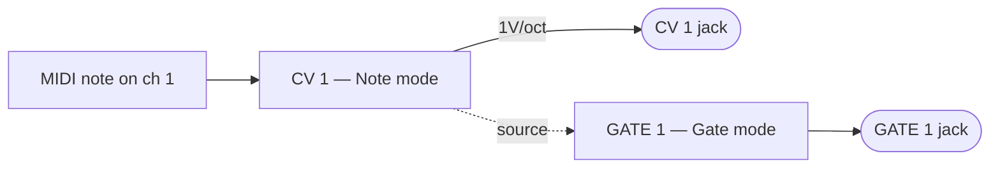
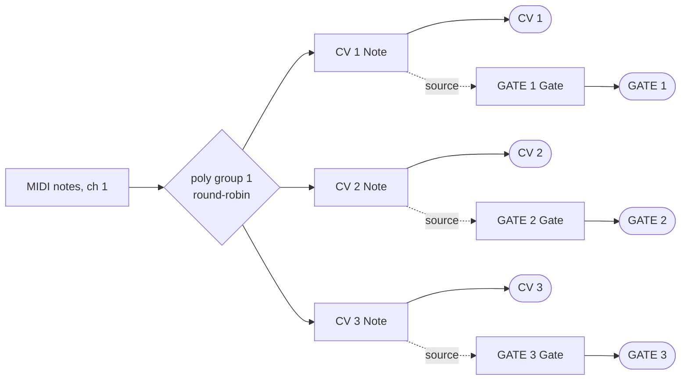
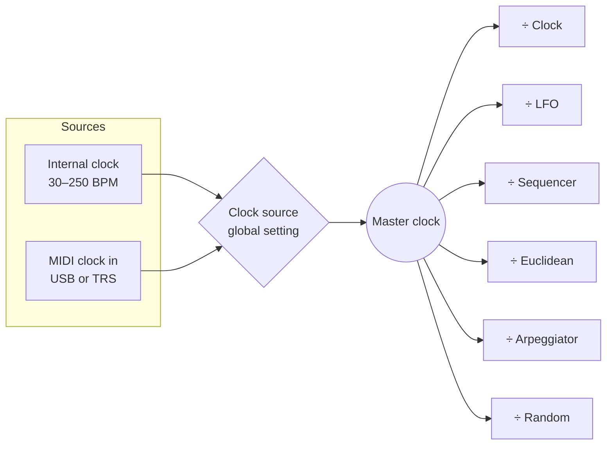
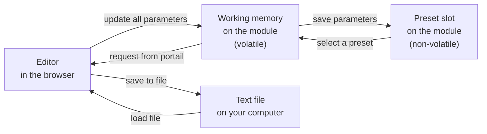

# Concepts

Read this once. Every reference page in this manual assumes it and assumes
nothing else.

The official manual introduces these ideas scattered across thirty pages, mostly
after the point where you need them. Here they are in dependency order.

---

## 1. Sixteen outputs, in two banks

Portail has **16 output jacks**, and every one of them is assignable. There is no
fixed "this jack is pitch, that jack is gate".

The jacks are grouped into two banks, and the banks differ in what voltage they
can produce:

| Bank | Jacks | Resolution | Voltage range |
|---|---|---|---|
| **CV** | CV 1 – CV 8 | 16-bit | −5 V to +10 V, bipolar |
| **Gate** | GATE 1 – GATE 8 | 12-bit | 0 V to +10 V, unipolar |

That is the *only* difference. A Gate output is not restricted to gates — it can
produce an LFO, an envelope, a clock, a control voltage from a CC. eowave calls
them **Gate outputs** ("dynamic gates") to make this point, and the product page
describes the module as having "16 CV" for the same reason.

What follows from the table:

- **Pitch must come from a CV output.** 1 V/oct tracking over a useful range
  needs the bipolar swing and the 16-bit resolution. Gate outputs cannot go
  below 0 V, so they cannot express notes below the reference octave.
- **A Gate output is the better choice for anything unipolar** — gates, triggers,
  clocks, positive-only envelopes — because it leaves your CV outputs free for
  the things that genuinely need them.
- 12-bit is 4096 steps across 10 V, about 2.4 mV per step. Fine for modulation,
  visibly steppy if you try to use it for pitch.

Throughout this manual, **CV output** and **Gate output** mean the physical
jacks. When the distinction does not matter, **output** means either.

---

## 2. A mode is what one output does

Each of the 16 outputs is set to exactly one **mode**. The mode is the first
dropdown for that output in the editor, which the official editor labels `type`.

The mode determines three things at once: what MIDI the output listens to, what
appears at the jack, and which further parameters that output has. Choosing
`LFO` and choosing `Note` give you two completely different sets of controls on
the same row.

The two banks have overlapping but not identical mode lists:

| Mode | CV | Gate |
|---|---|---|
| Off | yes | yes |
| Note | yes | — |
| Gate | — | yes |
| Trigger, MIDI CC, Velocity, Aftertouch, Poly aftertouch, Pitch bend | yes | yes |
| Clock, LFO, Envelope, Sequencer, Random | yes | yes |
| Arpeggiator | yes | — |
| CC recorder | yes | — |
| Euclidean | — | yes |

Note is CV-only because pitch needs the bipolar range. Gate, as a mode, is
Gate-bank-only. Arpeggiator and CC recorder are CV-only; Euclidean is Gate-only.

Modes that appear in both banks behave the same way but offer a different
**Level range** menu, because the banks have different voltage limits. A `MIDI CC` on a CV
output can be set to `−3 V`; a `MIDI CC` on a Gate output cannot.

See [the mode reference](modes/index.md).

---

## 3. Channels are per-output, not global

Almost every mode has a **Channel** parameter, set independently per output. There
is no single "the module's MIDI channel".

This is what makes multitimbral setups work: CV 1 can take channel 1, CV 2 can
take channel 2, and they ignore each other entirely.

There is one **global CC channel** in the global settings, and it does something
different — it selects which channel the [CC map](#7-the-cc-map-controls-parameters-from-cc)
listens on for remote parameter control. It does not affect note routing.

---

## 4. Outputs can listen to each other

Several modes have a **Trigger source** parameter that can point at a **CV output**
instead of at a MIDI channel. On Gate, Trigger, Velocity and Envelope, **Trigger source** offers
`Note` (meaning: all notes on this output's MIDI channel) or `CV 1` … `CV 8`.

Setting **Trigger source** to a CV output means "follow whatever note that output is
playing". This is the mechanism that binds a gate to a pitch:

GATE 1 does not need to know the channel — it inherits it from CV 1. The editor
hides the **Channel** parameter when you select a CV source, for exactly this
reason.

This matters most for polyphony, below.

**Beware the two meanings of **Trigger source**.** The word is reused:

- On Gate, Trigger, Velocity, Envelope — **Trigger source** is *where to follow from*: a channel's
  notes, or a CV output.
- On Poly aftertouch — **Trigger source** is *which MIDI note number* to track aftertouch for.
- On Random — **Trigger source** is *what triggers a new value*: `Note` or `Clock`.
- On Clock — the parameter the editor labels `source` is the **Clock event**, and
  selects the *event type*: `Clock`,
  `Start/stop` or `Reset`.

Each mode page states which meaning applies.

---

## 5. Polyphony is several CV outputs sharing a group

There is no "poly mode" switch. You build a polyphonic voice out of outputs.

On a CV output in Note mode, the **Voice mode** parameter chooses the voice
assignment:

- `Mono last`, `Mono low`, `Mono high` — monophonic, with last-note, lowest-note
  or highest-note priority.
- `Poly group 1` … `Poly group 4` — this output joins a group.

**The polyphony count is however many CV outputs you put in the same group.**
Set CV 1, CV 2 and CV 3 all to `Poly group 1` and you have a three-voice
allocator: incoming notes are handed out one per output, round-robin.

Then bind gates to the voices by setting each Gate output's **Trigger source** to the
matching CV output:

Four groups exist, so you can run several independent polyphonic parts at once —
for example a three-voice part on channel 1 in group 1 and a two-voice part on
channel 2 in group 2.

Worked example: [Recipes → three-voice poly synth](recipes/poly-synth.md).

---

## 6. FX slots are eight processors that point at an output

An **FX slot** processes MIDI on its way to an output. There are **8 FX slots**, and they are a separate resource from the
16 outputs — using an FX slot does not cost you a jack.

Each slot has:

- an **FX type** — which effect this is, or `OFF`
- a **Target** — which output it applies to
- its own parameters

A slot affects **one destination output**. It is not global, and it is not
per-channel. If you want the same effect on two outputs, you spend two slots.

### How they stack

Point several slots at the same destination and they chain, **in slot order**:

Slots 3 and 4 are skipped here because they point somewhere else, or are `OFF`.
The chain is FX 1 → FX 2 → FX 5, then the output.

**Order changes the result**, and the order is the slot order, not the order you
configured them in. Quantising and then randomising gives you off-scale notes;
randomising and then quantising keeps you in scale. If a chain is doing the wrong
thing, check which slot number each effect is in.

### Two domains

FX split into two families by what they can process:

| Domain | Operates on | Can target | FX |
|---|---|---|---|
| **Note** | note numbers, before pitch is produced | CV outputs | Note filter, Random octave, Random note, Chance, Accumulate, Transpose, Scale, Microtonal |
| **Gate** | gate events, timing and level | Gate outputs | Delay, Humanize, Logic, Random velocity, Random trig length, Invert, Repeats |

The **Target** menu enforces this: a Note FX slot only offers CV 1–8, a
Gate FX slot only offers GATE 1–8. You cannot put Scale on a gate.

A Note FX slot only does something if the destination CV output is in a
mode that handles notes — `Note`, `Arpeggiator`, `Sequencer` or `Random`. Pointing Scale at a
CV output running `LFO` has no effect.

**Microtonal is always applied last**, whatever slot it is in, because it
replaces the pitch table rather than editing note numbers. See
[Microtonal](fx/microtonal.md).

See [the FX reference](fx/index.md).

---

## 7. The CC map controls parameters from CC

Separately from modes and FX slots, Portail can expose its own parameters to
incoming MIDI CC, so an external controller can change them live.

- **32 mapping slots.**
- Each slot binds one incoming **CC number on one channel** to one **parameter of
  one row** — a CV output, a Gate output, an FX slot, or the global
  settings.
- Each slot has a **min** and a **max**, so you can scale the CC's 0–127 into
  just the part of the parameter's range you want, or invert it by setting min
  above max.
- Assignment is by MIDI learn: arm the slot, send the CC, it captures the number
  and channel.

This is how you get a knob on the ADSR times, or on a random generator's range,
without touching the editor.

There is also a **default CC map** built into the firmware, which pre-assigns a
CC to most parameters. It can be switched off with the global **Disable default
midi mapping** setting. See [Appendix: default CC map](appendix-cc-map.md).

**A mapping is bound to the output's current mode.** If you change a output's **Mode**,
any mapping pointing into that output is deleted, because the parameter it pointed
at no longer exists.

---

## 8. One master clock feeds everything time-based

Clock, LFO, Sequencer, Euclidean, Arpeggiator, Random (when its source is `Clock`) and Repeats
all run from a single **master clock**. You do not set a rate on each of them —
you set a **division** of the master clock.

The master clock is either:

- **internal** — Portail generates it, at a tempo you set (30–250 BPM from the
  editor's slider), or
- **external** — Portail follows MIDI clock arriving on USB or TRS.

This is a global setting, not per-output. It is the reason the global settings
matter before any of the time-based modes make sense.

Divisions are written musically — `1/4` is a quarter note, `1/16` a sixteenth,
`1/8T` an eighth triplet, `1/8.` a dotted eighth. `1/1` is a bar of 4/4 and the
list runs up to `4/1`, four bars.

`TODO(verify)`: the master clock's internal resolution in PPQN is not stated in
any primary source. It matters if you want a `1/4` division to line up exactly
with a 24-PPQN external clock. **Test:** set clock source to external, feed
Portail a known MIDI clock, set a Gate output to `Clock` mode with **Clock division** `= 1/4`,
and compare its pulses against your sequencer's quarter-note output on a scope
or by ear over 32 bars, listening for drift.

For getting a sequencer clocked correctly, see
[Recipes → clocking a sequencer](recipes/clocking.md).

---

## 9. Presets, and the difference between sending and saving

A **preset** is a complete snapshot of the module's configuration: all 8 CV outputs,
all 8 Gate outputs, all 8 FX slots, the global settings, and all 32 CC map
mappings. **There are 8 preset slots.**

There are three places your configuration can be, and they are not the same
place:

The distinction that catches people:

- **update all parameters** sends the editor's settings to the module's working
  memory. They take effect immediately. **They are lost at power-off.**
- **save parameters** writes working memory into the currently selected preset
  slot, overwriting it. This survives power-off.

So the sequence "it sounded right, I powered down, it's gone" means you sent but
never saved.

**save to file** is the only backup that is not on the module. Use it before
overwriting a factory preset — see [the editor](editor.md#backing-up).

---

## 10. What is on the module and what is in the editor

| | On the module | In the editor |
|---|---|---|
| Runs the modes and FX slots | yes | no |
| Holds the 8 presets | yes | no |
| Deep configuration of every parameter | no | yes |
| Preset recall | yes | yes |
| MIDI learn for the CC map | limited | yes |
| Firmware update | via bootloader | provides the file |

The editor is a web page that talks to the module over USB using SysEx. It holds
no state of its own beyond what is on screen. Closing it changes nothing on the
module; the module keeps running whatever is in its working memory.

The module has **two buttons and per-output LEDs** — no screen. It can recall
presets and do simple assignments without a computer. See
[On-module controls](on-module.md).

Nothing about the editor is required at run time. Once configured and saved, the
module works standalone with USB unplugged.

---

## Terms, briefly

| Term | Means |
|---|---|
| **Output** | One of the 16 physical jacks |
| **CV output** | One of CV 1–8. 16-bit, −5 V to +10 V |
| **Gate output** / **Gate output** | One of GATE 1–8. 12-bit, 0 V to +10 V |
| **Bank** | The CV group or the Gate group |
| **Mode** | What one output does. The **Mode** dropdown |
| **FX** / **FX** | One of 8 slots that processes MIDI toward one output |
| **Slot** | An FX slot position, 1–8. Determines chain order |
| Target | The output an FX slot applies to |
| Trigger source | Context-dependent — see [§4](#4-outputs-can-listen-to-each-other) |
| **Poly group** | One of 4 round-robin voice pools |
| **CC map** | The 32 CC-to-parameter mappings |
| **Master clock** | The single internal or external clock all timed modes divide |
| **Div** | A musical division of the master clock |
| **Working memory** | Volatile live configuration on the module |
| **Preset** | One of 8 non-volatile configuration slots |
| **Latch** | A length setting meaning "hold for as long as the note is held" |

The canonical glossary lives in `spec/glossary.md`. Where that file and this
table differ, `spec/glossary.md` wins and this table is the thing to fix.
