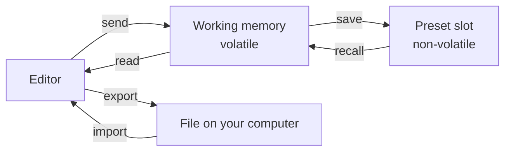

# The editor

Portail has no screen. Deep configuration happens in a web editor that talks to
the module over USB using SysEx.

There are two editors:

- **The official eowave editor**, at <https://www.eowave.app/portail/>. This is
  what ships with the module and what the official manual documents. It is also
  where firmware updates come from.
- **The companion editor in this project**, in `app/`. An alternative for
  day-to-day configuration.

This page describes the concepts, which apply to both, and then the differences.
It deliberately avoids describing button positions and screen layouts, because
those change.

---

## What an editor can and cannot do

An editor is a remote control for the module's memory. It holds no state of its
own beyond what is on screen. Closing it changes nothing; the module keeps
running whatever you last sent.

Nothing about an editor is required at run time. Once configured and saved, the
module works standalone with USB unplugged.

---

## Connecting

1. **Power the module from your case.** USB alone is not enough — the module
   needs rack power to run. `TODO(verify)`: whether the module enumerates over
   USB with no rack power connected. **Test:** with the case off, connect USB and
   see whether the editor's device list offers `Portail`.
2. **Connect USB-C** from the module to your computer.
3. **Open the editor in a browser that supports Web MIDI.** Chrome and
   Chromium-based browsers work. Firefox and Safari historically do not — check
   <https://caniuse.com/midi> for the current state.
4. **Accept the MIDI permission prompt** when the browser asks. Web MIDI requires
   explicit permission, and SysEx access is a separate, stricter permission that
   some browsers prompt for individually.
5. **Select `Portail`** from the editor's device list.
6. **Read the current configuration from the module** before changing anything.

Step 6 matters more than it looks. An editor starts empty or with defaults. If
you change one parameter and send everything, you overwrite the module's other 23
rows with whatever the editor happened to be showing. Always read first.

### iOS does not work

Apple's browsers do not implement the Web MIDI API, so the editor cannot connect
from an iPhone or iPad through Safari or Chrome for iOS. The official manual
suggests the third-party **Web MIDI Browser** app as a workaround.

Android with Chrome works.

---

## The three places a configuration can live

This is the concept that causes the most lost work.

- **Editor** — what is on your screen. Not on the module at all.
- **Working memory** — what the module is running right now. Volatile. Lost at
  power-off.
- **Preset slot** — one of 8 non-volatile slots. Survives power-off.

The two operations people confuse:

| Operation | Official editor | What it does |
|---|---|---|
| Send | **update all parameters** | Editor → working memory. Takes effect immediately. **Lost at power-off** |
| Save | **save parameters** | Working memory → the currently selected preset slot. Permanent |

**"It worked, then I powered down, and it's gone"** means you sent but never
saved. Sending and saving are two separate actions and you need both.

Reading goes the other way: **request from portail** copies working memory back
into the editor.

---

## Presets

There are **8 preset slots**. A preset holds everything: all 8 CV outputs, all 8
Gate outputs, all 8 FX slots, the global settings, and all 32 CC map
mappings.

Selecting a preset loads it into working memory, replacing what was there. Any
unsaved changes are lost at that moment, without warning.

Saving writes working memory into **the currently selected slot**, overwriting
it. There is no "save as" — to put a configuration in a different slot, select
that slot first, then send, then save.

The official manual contradicts itself about how many presets exist, saying 16 in
one place and 8 in another. It is 8. See [audit §2](audit.md).

---

## Backing up

**Do this before you overwrite anything.**

The factory presets are not published. Once you save over preset 1, its original
contents are gone and there is no way to recover them. Nothing on eowave's site
or in the manual provides a restore file.

The procedure, using the official editor:

1. Select preset 1.
2. **request from portail** — pulls it into the editor.
3. **save to file** — writes a text file to your computer. Name it clearly:
   `portail-factory-preset-1.txt`.
4. Repeat for presets 2 through 8.

Keep those eight files somewhere safe. They are the only backup of the factory
configuration that will exist.

The official editor's file format is plain text: one line per row, values
separated by semicolons, 24 rows, then the global parameters, then 32 CC map
lines. It is readable and diffable, which makes it reasonable for version
control.

---

## Global settings

Eight settings that affect the whole module rather than one output. They are part
of the preset, so they are saved and recalled with everything else.

| Setting | Values | What it does |
|---|---|---|
| Clock state | `stop`, `start` | Runs or halts the master clock. With it stopped, every clocked mode is silent |
| Clock source | `Internal`, `External` | Whether the master clock is generated here or follows incoming MIDI clock |
| Speed | 30–250 BPM | Internal clock tempo. Ignored when the source is external |
| Active midi out copy | `Off`, `On` | Passes incoming MIDI to a MIDI output — see the caveat below |
| Reset on continue | `Off`, `On` | Whether a MIDI Continue resets to the start or resumes in place |
| Global CC channel | `ch 1` – `ch 16` | Which channel the CC map and default CC map listen on |
| Disable default midi mapping | `Off`, `On` | Switches off the firmware's built-in CC assignments |

Three of these are worth expanding.

**Clock source** is the setting that makes [Clock](modes/clock.md),
[LFO](modes/lfo.md), [Sequencer](modes/seq.md), [Euclidean](modes/euclidean.md),
[Arpeggiator](modes/arp.md) and [Random](modes/random.md) work or not work. If a clocked
mode does nothing, check this and Clock state first. See
[Concepts §8](concepts.md#8-one-master-clock-feeds-everything-time-based).

**Reset on continue** has a name that does not explain it. It controls what
happens on MIDI Continue — the message a sequencer sends when resuming from a
paused position rather than from the start. `On` treats Continue as a Start and
resets everything; `Off` resumes in place. `On` is the safer default. See
[Recipes → clocking](recipes/clocking.md#reset-on-continue).

**Disable default midi mapping** turns off the firmware's built-in CC map. That
map is active unless you disable it, and its assignments are unpublished — so if
a parameter changes when you touch a controller and you did not map it, this is
the first thing to try. See [Appendix: default CC map](appendix-cc-map.md).

**Active midi out copy** refers to a MIDI output whose existence is not
confirmed. The setting works in the editor and the official manual describes it,
but no connector list mentions a MIDI output on the module. See
[Specifications](specifications.md#the-midi-output-question).

The editor's tempo slider stops at 250 BPM. The underlying tempo parameter covers
30–284 BPM in 2 BPM steps, so a [CC map](#the-cc-map) mapping can reach
tempos the slider cannot.

---

## The CC map

Setting up CC control of parameters, in either editor:

1. **Add a mapping slot.** There are 32.
2. **Learn a CC.** Arm the slot, then send the CC from your controller. The slot
   captures the CC number and its channel.
3. **Choose a destination.** First the output — a CV output, a Gate output, a
   FX slot, or the global settings — then the parameter within it.
4. **Set **Low note** and **High note**.** These scale the CC's 0–127 into just the part of the
   parameter's range you want. Setting **Low note** above **High note** inverts the control.
5. **Send, then save.** Mappings live in working memory like everything else, so
   they vanish at power-off unless you save.

**A mapping is bound to the output's current mode.** Change a output's **Mode** and any
mapping into that output is deleted, because the parameter it referenced no longer
exists. Configure your modes first, then your mappings.

See [Concepts §7](concepts.md#7-the-cc-map-controls-parameters-from-cc) and
[Appendix: default CC map](appendix-cc-map.md).

---

## The Tuning tab

The companion editor has a **Tuning tab** for authoring the module's eight
microtonal tables and sending them to the module. This is what makes the
[Microtonal](fx/microtonal.md) mode useful: the tables all ship as standard
tuning, and the Tuning tab is how you replace one with a scale of your own.

### What it does

- **A local library of tunings.** Each tuning is **12 cents values, one per pitch
  class** (C, C♯, D … B). The module adds the octave (1200 cents) itself, so you
  only enter the twelve pitch classes — not every note. **C is normally 0; a
  non-zero root transposes the whole table** (the quarter-tone preset below uses
  C = 50). You build up a library of named tunings that lives in the editor, not
  on the module.
- **Import and export Scala `.scl` files**, the standard interchange format for
  tunings, so you can bring in scales from anywhere and share your own.
- **Send to module → table 1–8.** Pick one of the eight table slots and send the
  selected tuning to it. From then on, any [Microtonal](fx/microtonal.md) FX slot
  pointed at that table plays your scale.

### The `.scl` import rules

Portail's tables are exactly **12 pitch classes** and the module **always repeats
at the octave**. So the Tuning tab accepts only Scala scales that fit that shape:

- **Must be 12-note.** A scale with any other number of degrees is refused, with a
  message naming the count — a 7-note or 19-note scale cannot map onto twelve
  fixed pitch classes, and a **24-note 24-TET file is refused** for the same
  reason (use the paired-output approach
  [below](#quarter-tones-and-why-24-tet-needs-two-outputs) instead).
- **Must repeat at the octave (1200 cents).** A scale whose period is not the
  octave — Bohlen–Pierce, for instance — is refused, because the module has no way
  to represent a non-octave period.
- **Both pitch formats parse.** Scala degrees written as **ratios** (`3/2`, `5/4`,
  a bare integer like `2` meaning `2/1`) and as **cents** (`701.955`) are both
  accepted; ratios are converted to cents on import.

Refusals are explained in the message, so you always know why a file did not
load rather than getting a silent failure.

### Quarter-tones, and why 24-TET needs two outputs

The Tuning tab ships with a factory preset, **Quarter-tone (24-TET offset)** —
every pitch class raised a quarter-tone: cents `[50, 150, 250, … 1150]`.

It exists because of a hard limit worth understanding. A single Portail table
holds **only 12 pitch classes and always repeats at the octave**. True 24-TET has
**24 pitches per octave**, so it cannot fit one table — and a 24-note Scala `.scl`
file is correctly **refused on import**, because it has 24 notes where a table
holds 12.

The way to play 24-TET is to **pair two outputs**:

- one output on a plain **12-TET** table — the normal semitone grid, and
- a second output on the **Quarter-tone (24-TET offset)** table — the same grid
  shifted up 50 cents.

Together the two outputs cover the full 24-TET set: the standard twelve pitches
from the first, the twelve quarter-tone-sharp pitches from the second. Split your
MIDI across the two outputs (by channel, or by [Note filter](fx/note-filter.md))
and you have quarter-tones across your rack.

This is the technique used for quarter-tone material in the vein of **Angine de
Poitrine**, the Québécois microtonal band whose tuning sits around 24-TET — the
motivating case the preset was built for.

### Honesty: what the app can and cannot promise

Three limits are worth understanding before you rely on a custom tuning. Each is
also a `TODO(verify)` — see [unverified.md](unverified.md).

- **The write format is firmware-derived, not yet hardware-confirmed.** The way
  the editor writes a table was recovered from the firmware, not proven on a real
  module. So the **first send is gated behind a one-time confirmation**, and the
  tuning is flagged **Unverified** until you confirm it. After sending, play a
  chromatic run: if it plays in tune, mark it confirmed and the warning stops.
  `TODO(verify)`: that the table-write format is correct on hardware. **Test:**
  send a table with an obvious offset — say C♯ at 150 cents instead of 100 — and
  check that C♯ plays noticeably sharp.
- **The module cannot report a table back.** There is no read path for tunings, so
  the editor only tracks **what it last sent**. If a table was set some other way,
  or on another computer, the editor has no way to know — it shows its own history,
  not the module's true state. `TODO(verify)`: whether any read-back path exists.
  **Test:** send a table, reload the editor, and see whether it can recover the
  table's contents from the module (it should not be able to).
- **A sent table may not survive a power-cycle.** Sending writes to the module's
  **working memory**, and there is no confirmed save-to-flash path for tunings. So
  treat a custom tuning as **live**, like a patch you have sent but not saved:
  after powering the module on, re-send the table. `TODO(verify)`: whether a sent
  tuning persists across power-off. **Test:** send a distinctive table, power the
  case off and on, and play the same notes — if they revert to standard tuning,
  tunings are working-memory only.

None of this can harm the module: a tuning write goes to RAM, cannot brick it,
and is undone by a power cycle.

---

## Firmware updates

**Firmware updates are done with the official eowave editor, not the companion
editor in this project.**

The companion editor is configuration and presets only, by design. Flashing
firmware means writing to a device in bootloader mode where a failure leaves the
module unusable, and that is not a risk worth taking on an unofficial tool. The
official editor is also the authoritative source for the firmware file itself —
a third-party tool distributing firmware images would be a way for the wrong
image to reach a module.

So the split is: use the companion editor for everyday configuration, and go to
<https://www.eowave.app/portail/> when you need to update firmware.

### The update procedure

Summarised from the official manual. Follow eowave's own instructions in
preference to these.

1. In the official editor's global settings, download the latest firmware. It is
   a `.uf2` file.
2. Connect the module to your computer over USB.
3. **Power the module down.**
4. **Hold the left button (▼) and power the module up** while still holding it.
5. The module appears as a USB drive named **`RPI-RP2`**. Accept any permission
   prompt.
6. Drag the `.uf2` file onto that drive.
7. The drive disconnects on its own and the module reboots, updated.

This is the standard RP2040 bootloader flow — Portail is built on an RP2040 — so
if you have flashed a Raspberry Pi Pico, it is the same procedure.

**Back up your presets before updating.** `TODO(verify)`: whether a firmware
update preserves the 8 stored presets. **Test:** back up all 8 to files, update,
then read each preset back and compare against the files.

The official manual does not say how to check which firmware version you are
running. The editor requests a version string over SysEx and displays it, so the
information is available — look for a version readout once connected.

---

## The companion editor in this project

`app/` holds an alternative editor. Its scope is deliberately narrow:

| Included | Not included |
|---|---|
| Connection state, clearly shown | Firmware flashing |
| Offline editing with explicit send/read sync | Patch librarian |
| Overview of all 16 outputs at once | Live-tweak mode |
| JSON config import and export | |
| MIDI monitor | |
| Preset backup | |
| Microtonal tuning tables (the Tuning tab) | |
| Undo | |

Two of those are worth explaining.

**Explicit send/read sync.** The editor does not push changes as you make them.
You edit offline, see what has changed, and send deliberately. This makes the
distinction between the editor, working memory and the preset slot visible rather
than something you have to remember.

**MIDI monitor.** Shows what is arriving at the module. This is the fastest way
to answer "is my controller actually sending anything?", which is the first
question in most troubleshooting.

For what the companion editor does today, see `app/`'s own documentation. This
manual describes the module, not the tool.

---

## If the editor cannot see the module

**No devices in the list at all.** The browser does not support Web MIDI, or
permission was denied. Try Chrome. Check the site permissions for MIDI and reset
them if a previous denial is cached.

**`Portail` is listed but nothing connects.** Another application may have the
port open — a DAW, or another browser tab with an editor in it. On some systems a
USB MIDI device can only be opened once. Close everything else and reload.

**It connected, then stopped.** Unplugging and replugging the USB cable does not
always re-establish the browser's connection. Reload the page. The official
manual notes this specifically for phones.

**It connects but reads back nothing.** The module may be powered from USB but
not from the rack. Confirm the case is on.

More in [Troubleshooting](troubleshooting.md).
