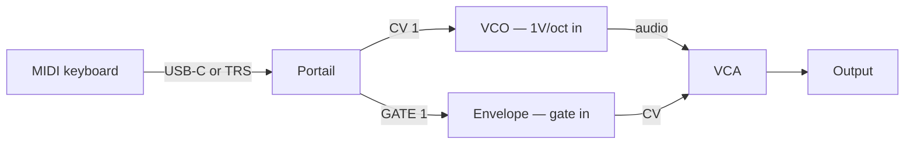

# Quick start

Goal: a MIDI keyboard plays a note, and an oscillator in your rack tracks it.

This takes about five minutes. Do it before you configure anything, because it
proves the module, the cable, the power and your MIDI source all work while
there is still only one thing that can be wrong.

---

## 1. Power the module down and install it

Portail is 5 HP and draws **110 mA on +12 V, 20 mA on −12 V, 0 mA on 5 V**.

1. Turn your case off.
2. Plug the 10-pin end of the ribbon cable into the header on the back of
   Portail. **The red stripe goes to −12 V.** The header is keyed on most cases
   but check the silkscreen.
3. Plug the 16-pin end into your bus board, red stripe to −12 V.
4. Screw the module into the rails.
5. Turn the case on.

Portail has reverse-polarity protection, so a backwards cable will not destroy
it. It will simply not start.

**You should see:** the output LEDs light. If nothing lights at all, go to
[Troubleshooting → the module shows no sign of life](troubleshooting.md#the-module-shows-no-sign-of-life).

---

## 2. Connect a MIDI source

Two inputs, either one works:

- **USB-C** — to a computer, phone or tablet. Portail appears as a class-compliant
  USB MIDI device named `Portail`. No driver needed.
- **TRS MIDI** — 3.5 mm, **Type A** wiring. If your controller has a 5-pin DIN
  socket, you need a DIN-to-TRS-A adapter. A Type B cable will not work; this is
  the single most common cause of "no MIDI at all" on the TRS input.

For this first test, use whichever is quicker. A USB keyboard plugged into a
computer running a DAW, with the DAW's output set to `Portail`, is fine.

---

## 3. Patch two cables

You need one oscillator with a 1 V/oct input and one envelope or VCA with a gate
input. Any voice will do.

- **CV 1** → your oscillator's 1 V/oct input.
- **GATE 1** → your envelope's gate or trigger input.

Turn your monitors down before the next step.

---

## 4. Play

Play a note on the keyboard, on **MIDI channel 1**.

**You should hear** a pitched note that starts when you press the key and stops
when you release it, and that tracks the keyboard an octave per twelve
semitones.

That is the whole test. If it worked, the module is fine and everything from here
is configuration.

---

## Why that worked without configuring anything

Portail ships with a factory preset in which **CV 1 is set to Note mode on
channel 1** and **GATE 1 is set to Gate mode with its source set to CV 1**.
That pairing — a pitch output and a gate output that follows it — is the default
in preset 1.

`TODO(verify)`: the exact contents of factory presets 1–8 are not published, and
the editor's source contains only its own per-mode defaults, not the module's
factory presets. **Test:** connect the editor, select each preset in turn from
the preset menu, click **request from portail**, and use **save to file** to dump
each one. Compare the eight files. That gives you the real factory contents, and
it is worth doing before you overwrite anything.

---

## If you heard nothing

Work down this list in order. Each step rules out one thing.

1. **Is MIDI arriving at all?** The module's LED activity should respond to
   incoming MIDI. If the LEDs are static while you play, the problem is upstream
   of Portail — wrong port selected in your DAW, or a TRS Type B cable.
2. **Are you on channel 1?** The factory preset listens on channel 1. Many
   controllers default elsewhere.
3. **Is the gate reaching the envelope?** Patch GATE 1 into anything with an LED
   and confirm it blinks when you play.
4. **Is the pitch moving but wrong?** If notes play but the intervals are wrong,
   the oscillator's 1 V/oct input may be attenuated, or you may be listening to a
   quantised output. Portail's Note mode is unquantised by default.
5. Anything else: [Troubleshooting](troubleshooting.md).

---

## Next

- [Concepts](concepts.md) — read this before configuring anything. It is short
  and it will save you from the two mistakes everyone makes (assuming a gate
  output can only make gates, and assuming an FX slot applies to everything).
- [Recipes → Two-voice mono setup](recipes/index.md) — the natural next patch.
