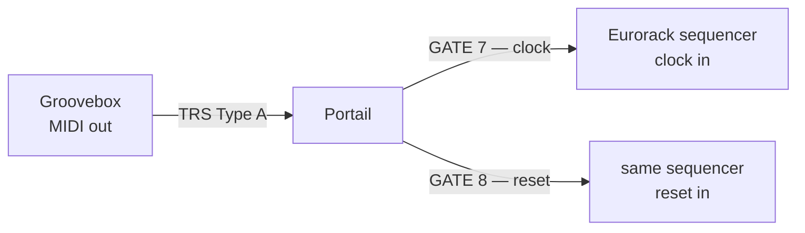

# Clocking a sequencer correctly

**Goal:** a Eurorack sequencer runs in time with your groovebox or DAW, starts
from step 1 when you press play, and stays in phase for as long as you leave it
running.

This is the thing people get wrong most often, and the failure is not obvious —
everything appears to work, then drifts out over a few minutes, or runs at four
times the speed you expected.

---

## The two questions you have to answer first

**1. What does your sequencer want?** There are two conventions and they are not
compatible:

| Convention | What the sequencer expects | Typical of |
|---|---|---|
| **Step-per-pulse** | One pulse advances one step | Most Eurorack sequencers |
| **PPQN** | A fixed number of pulses per quarter note, usually 24 | Modules designed around MIDI or DIN sync |

If your sequencer is step-per-pulse and you want 16 steps per bar, you want a
pulse every sixteenth — **Clock division** `1/16`.

If your sequencer wants 24 PPQN, you need 24 pulses per quarter note, and
Portail's division menu is musical rather than PPQN-based. See
[the PPQN problem](#the-ppqn-problem) below.

**2. Where is the clock coming from?** Portail's master clock is either internal
or external, globally. With a groovebox as your master, you want **external**.

---

## Cabling

**The reset cable is not optional.** Without it the sequencer keeps its position
across transport stops, and after a few starts and stops it will be on step 7
when your groovebox is on step 1. Everything will sound almost right, which is
worse than sounding wrong.

---

## Settings

**Global settings** — in the editor's GLOBAL tab:

| Setting | Value |
|---|---|
| Clock source | `External` |
| Clock state | `start` |
| Reset on continue | `On` — see below |

**Outputs:**

| Output | **Mode** | **Clock event** | **Clock division** | **Length** | **Level range** | **Swing** |
|---|---|---|---|---|---|---|
| GATE 7 | `Clock` | `Clock` | `1/16` | `5 ms` | `10 V` | `OFF` |
| GATE 8 | `Clock` | `Reset` | — | `5 ms` | `10 V` | — |

The **Channel** parameter on a Clock output has no effect. Leave it at whatever it
is.

Press **update all parameters**, then **save parameters**.

---

## What you should hear

Press play on the groovebox. The Eurorack sequencer starts from step 1 and
advances one step per sixteenth note. Stop and press play again: it returns to
step 1.

Let it run for several minutes alongside the groovebox. Nothing should drift.

---

## The PPQN problem

MIDI clock is defined as **24 pulses per quarter note**. Portail receives that
and divides it down into the musical divisions in its **Clock division** menu. So for a
step-per-pulse sequencer, **Clock division** does exactly what you want and there is nothing
to think about.

The trouble is a sequencer that wants raw 24 PPQN on its clock input. Portail's
menu has no `1/24` entry, and there is no `PPQN` setting.

`TODO(verify)`: **whether any clock division setting produces 24 pulses per quarter
note.** The division list is `4/1, 2/1, 1/1, 1/2, 1/4, 1/8, 1/16, 1/32` plus
triplets and dotted values. `1/32` gives 8 pulses per quarter note; a `1/16T`
triplet gives 6 per quarter. None is obviously 24.

**Test:** set **Clock division** `1/4` and count Portail's pulses against your groovebox's
quarter notes over 16 bars — they should be 1:1. Then set **Clock division** `1/32` and count
again; you should get 8 per quarter note. If those hold, the divisions are
musical as documented and 24 PPQN is not directly available, and you will need a
clock multiplier module between Portail and a PPQN-hungry sequencer.

Most Eurorack sequencers are step-per-pulse, so this affects a minority of
setups — but if your sequencer is running far too slowly and no **Clock division** setting
fixes it, this is why.

---

## Reset on continue

A global setting whose name does not explain it. It controls what Portail does
when it receives MIDI **Continue** — the message a sequencer sends when resuming
from a paused position rather than from the start.

- **`On`** — a Continue is treated like a Start, and everything resets to the
  beginning.
- **`Off`** — a Continue resumes where things left off.

The official manual calls it "A specialized function for compatibility with
certain sequencers or Ableton live" and says no more. `On` is the safer default
because it makes stop-and-start behaviour predictable; turn it `Off` only if you
specifically want pause-and-resume.

---

## Using Portail's own clock instead

If you have no external master, Portail can be the clock:

| Setting | Value |
|---|---|
| Clock source | `Internal` |
| Clock state | `start` |
| Speed | 30–250 BPM |

Everything else stays the same. Note that the editor's tempo slider stops at
250 BPM, but the tempo parameter reached through a
[CC map](../concepts.md#7-the-cc-map-controls-parameters-from-cc) mapping
covers 30–284 BPM in 2 BPM steps — so a mapped CC can push the tempo past what
the slider allows.

---

## If it doesn't work

**The sequencer runs at the wrong speed.** Your **Clock division** does not match what the
sequencer expects per step. If it is four times too fast, you are on `1/16` and
it wants `1/4`. Work it out by setting **Clock division** `1/4` and confirming one pulse per
beat, then divide from there.

**The sequencer doesn't start.** Check `clock state` is `start` in the global
settings — with it at `stop`, the internal clock is halted and nothing is
generated. With `clock source external`, also confirm your groovebox is actually
transmitting MIDI clock; many devices have it switched off by default.

**It starts but skips steps.** **Length** is too short for the sequencer's input.
Raise it from 5 ms to 10 ms.

**It runs but ignores the reset.** Confirm GATE 8 is set to **Clock event** `reset`, not
`Start/stop`. Also check whether your sequencer's reset input expects a trigger
or a gate — see the `TODO(verify)` on [Clock](../modes/clock.md).

**It drifts slowly out of phase.** You have no reset cable, or the reset input
is not connected to anything. Drift over minutes is almost always this.

**Everything is in time but feels wrong.** Check **Swing** is `OFF` on the clock
output. Swing on a master clock swings everything downstream, which is rarely
what you want — swing the parts instead.
