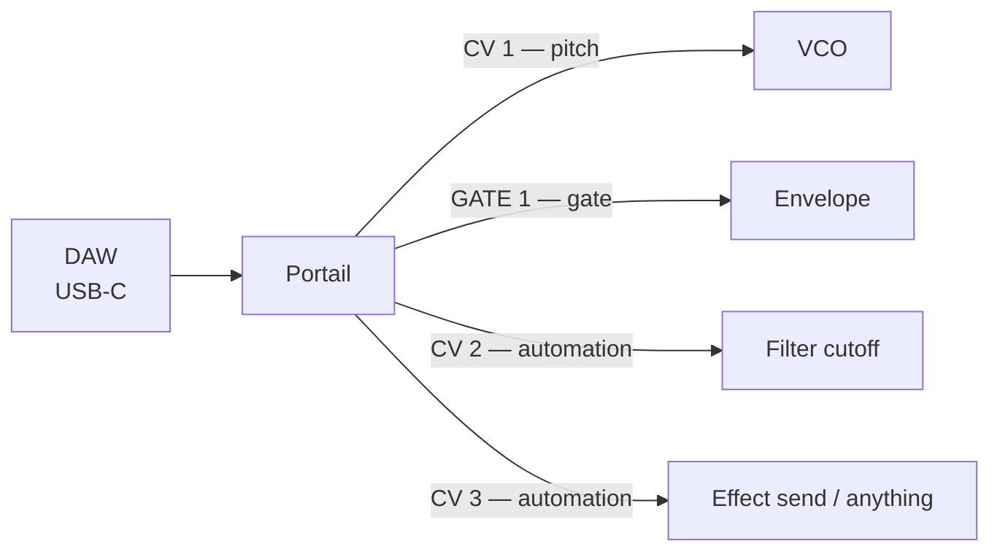

# A DAW-driven mono voice

**Goal:** one track in your DAW drives a monophonic voice in the rack, with
pitch, gate and two automation lanes.

This is the same voice as [multitrack CV/gate pairs](multitrack.md), configured
for a computer rather than a hardware sequencer. The difference is not the
module — it is that a DAW gives you automation lanes, and those map onto
[MIDI CC](../modes/cc.md) outputs.

---

## Cabling

One USB cable in, four cables out.

---

## DAW setup

1. Connect Portail with USB-C. It appears as a class-compliant MIDI device named
   `Portail`. There is no driver to install.
2. Create a MIDI track and set its **output** to `Portail`, channel 1.
3. Create two automation lanes on that track sending **CC 74** and **CC 21**.

CC 74 is the conventional filter-cutoff controller, so many DAWs and controllers
already have it mapped. CC 21 is in the 20–31 range that almost nothing uses by
default, which makes it safe for anything.

**Avoid CC 1.** It is the mod wheel, and it also sets vibrato depth on every
[Note](../modes/note.md) output on the same channel. Automating it will make your
pitch wobble.

---

## Settings

| Output | **Mode** | **Channel** | **Voice mode** | **Bend range** | **Vibrato rate** | **Glide** | **Legato** |
|---|---|---|---|---|---|---|---|
| CV 1 | `Note` | `ch 1` | `Mono last` | `+/-2` | `OFF` | `OFF` | `Off` |

| Output | **Mode** | **Trigger source** | **Level range** | **Velocity sensitive** | **Rise** | **Fall** | **Retrigger** |
|---|---|---|---|---|---|---|---|
| GATE 1 | `Gate` | `CV 1` | `10 V` | `On` | `OFF` | `5 ms` | `On` |

| Output | **Mode** | **Channel** | **CC number** | **Level range** | **Slew** |
|---|---|---|---|---|---|
| CV 2 | `MIDI CC` | `ch 1` | `74` | `5 V` | `20` |
| CV 3 | `MIDI CC` | `ch 1` | `21` | `5 V` | `10` |

Press **update all parameters**, then **save parameters**.

---

## What you should hear

Press play. The track's notes drive the oscillator's pitch, the envelope fires on
each note, and the two automation lanes move the filter and whatever CV 3 is
patched to.

**Velocity sensitive** `on` means the DAW's note velocities become gate height, so your
programmed dynamics carry through — see [velocity to VCA](velocity-vca.md).

---

## Why Slew is set on the MIDI CC outputs

A CC is 7-bit: 128 values across 5 V is 39 mV per step. On a filter cutoff that
is audible as zipper noise, especially on slow sweeps where the DAW sends a
stream of adjacent values.

**Slew** `20` on CV 2 slews between values and removes it. CV 3 gets less because
its destination is unspecified and lag may not be wanted.

`TODO(verify)`: the slew time in milliseconds for a given **Slew** value.
**Test:** set **Slew** `100`, **Level range** `10 V`, send CC 0 then CC 127, and time how
long the output takes to arrive. Halve the setting and check whether the time
halves.

---

## Latency

USB MIDI adds a small, generally consistent delay. It is usually not worth
worrying about, but two things help if it is:

- **Set your DAW's track delay** to compensate, once you have measured it.
- **Do not compensate with [Delay](../fx/delay.md)** on Portail — it only
  adds more, in steps of about 8 ms.

If timing accuracy matters more than convenience, drive Portail from hardware
over TRS instead. See [clocking a sequencer](clocking.md).

---

## Adding a second track

You have seven CV outputs and seven Gate outputs left. A second voice is a second
DAW track on channel 2:

| Output | **Mode** | **Channel** | **Voice mode** |
|---|---|---|---|
| CV 4 | `Note` | `ch 2` | `Mono last` |

| Output | **Mode** | **Trigger source** | **Level range** | **Retrigger** |
|---|---|---|---|---|
| GATE 2 | `Gate` | `CV 4` | `10 V` | `On` |

Repeat up to eight voices. See [multitrack CV/gate pairs](multitrack.md) for the
full layout.

---

## If it doesn't work

**The DAW doesn't see Portail.** Some DAWs enumerate MIDI devices only at
startup. Quit and reopen with the module already connected.

**Notes play but automation does nothing.** Check the CC number matches on both
sides, and that your automation lane is actually sending — many DAWs need the
lane armed or the track in a specific automation mode.

**The pitch wobbles when a lane moves.** You are automating CC 1. Move it to
another number, or set **Vibrato rate** to `OFF` on the Note row.

**Notes stick on when you stop the transport.** The DAW stopped without sending
note-offs. See
[Troubleshooting → a note is stuck on](../troubleshooting.md#a-note-is-stuck-on).

**The editor won't connect while the DAW is running.** On some systems a USB MIDI
device can only be opened by one application at a time. Close the DAW, configure
in the editor, save, then reopen the DAW. See
[the editor](../editor.md#if-the-editor-cannot-see-the-module).
