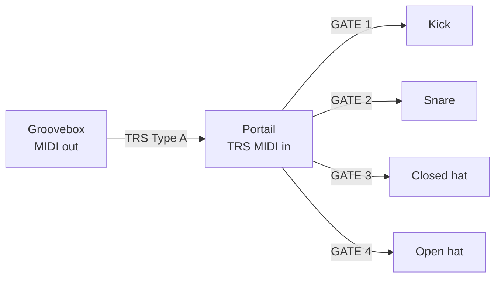

# Drum triggers from a groovebox

**Goal:** a hardware groovebox or drum machine, connected over TRS MIDI, fires
four separate drum modules in your rack — each on its own trigger output, each
responding only to its own part.

---

## What you need

- A groovebox or hardware sequencer with a MIDI output.
- A DIN-to-TRS **Type A** adapter, unless your device already has a 3.5 mm TRS
  MIDI out wired Type A.
- Four Eurorack modules with trigger inputs: kick, snare, hat, whatever you have.

---

## Cabling

Nothing goes into a CV output. Drums need timing, not pitch, so all four live on
the Gate bank and your CV outputs stay free.

---

## Two ways to split the parts

Your groovebox does one of two things. Check which before you configure anything.

**A. Each drum track sends on its own MIDI channel.** Common on Elektron boxes
and most modern grooveboxes. Split by **Channel**.

**B. All drums send on one channel, as different notes.** Common on drum
machines that follow the General MIDI convention, usually on channel 10. Split by
`Note`.

You can tell which by watching Portail's LEDs while you play a pattern, or by
checking your groovebox's MIDI settings page.

---

## Settings — option A, split by channel

Each output listens to a different channel and accepts any note on it.

| Output | **Mode** | **Channel** | **Trigger source** | `Note` | **Length** | **Velocity sensitive** | **Level min** | **Level range** |
|---|---|---|---|---|---|---|---|---|
| GATE 1 | `Trigger` | `ch 1` | `Note` | `all` | `5 ms` | `Off` | `0 V` | `10 V` |
| GATE 2 | `Trigger` | `ch 2` | `Note` | `all` | `5 ms` | `Off` | `0 V` | `10 V` |
| GATE 3 | `Trigger` | `ch 3` | `Note` | `all` | `5 ms` | `Off` | `0 V` | `10 V` |
| GATE 4 | `Trigger` | `ch 4` | `Note` | `all` | `5 ms` | `Off` | `0 V` | `10 V` |

Set your groovebox's four drum tracks to channels 1, 2, 3 and 4.

## Settings — option B, split by note

All four listen to the same channel and each accepts one note.

| Output | **Mode** | **Channel** | **Trigger source** | `Note` | **Length** | **Velocity sensitive** | **Level min** | **Level range** |
|---|---|---|---|---|---|---|---|---|
| GATE 1 | `Trigger` | `ch 10` | `Note` | `C1` | `5 ms` | `Off` | `0 V` | `10 V` |
| GATE 2 | `Trigger` | `ch 10` | `Note` | `D1` | `5 ms` | `Off` | `0 V` | `10 V` |
| GATE 3 | `Trigger` | `ch 10` | `Note` | `F#1` | `5 ms` | `Off` | `0 V` | `10 V` |
| GATE 4 | `Trigger` | `ch 10` | `Note` | `A#1` | `5 ms` | `Off` | `0 V` | `10 V` |

Those four notes are the General MIDI kick, snare, closed hat and open hat. If
your device uses different ones, read the note it sends for each pad and use
that.

**Remember Portail calls middle C `C3`.** If your groovebox calls the kick `C2`,
it is using C4-as-middle-C numbering and Portail will call the same note `C1`.
When in doubt, set `Note` to `all` on one output, play a single pad, and check
which note fires — then work from there.

Press **update all parameters**, then **save parameters**.

---

## What you should hear

Play a pattern. Each drum module fires on its own part and ignores the others.
Muting a track on the groovebox silences exactly one module.

---

## Adding dynamics

Turn **Velocity sensitive** to `On` and set **Level min** to `2 V` on the hats:

| Output | **Velocity sensitive** | **Level min** | **Level range** |
|---|---|---|---|
| GATE 3 | `On` | `2 V` | `10 V` |
| GATE 4 | `On` | `2 V` | `10 V` |

Now an accented hat produces close to 10 V and a ghost note produces just over
2 V. Most analogue drum modules respond to trigger amplitude, so the accents come
through as level and often as timbre.

**Level min** matters: without it, a soft hit produces a voltage too low to trigger
the module at all, and the ghost notes vanish rather than getting quieter. Set it
just above your module's trigger threshold.

---

## Making it less rigid

Two additions, once the basics work:

- **FX 1:** **FX type** `Humanize`, **Target** `GATE 3`, **Amount** `12%` — the hats stop landing
  exactly on the grid.
- **FX 2:** **FX type** `Random velocity`, **Target** `GATE 3`, **Level range** `60`, **Blend** `added` — and
  their level varies too. Requires **Velocity sensitive** `on`, which you have set above.

Keep both small. See [Humanize](../fx/humanize.md) and
[Random velocity](../fx/random-vel.md).

---

## If it doesn't work

**Nothing fires at all.** Almost always the TRS adapter. Portail's TRS input is
**Type A**; a Type B cable passes nothing. Test by connecting the groovebox over
USB instead — if it works on USB, the problem is the adapter, not the
configuration.

**One module fires on every drum.** That output has **Note** `all` when it should
have a specific note, or all your groovebox tracks are on the same channel and
you configured option A.

**Nothing fires but the LEDs respond.** MIDI is arriving and Portail is
triggering, so the problem is downstream: check **Level range** against what your drum
module expects, and raise **Length** from 5 ms to 10 ms in case the pulse is too
short.

**Some hits are missed at fast tempos.** **Length** is too long — a 50 ms trigger
at 1/32 notes is still high when the next one arrives. Drop it to 3 ms.

**Accents don't come through.** **Velocity sensitive** is `Off`, or your groovebox is sending
a fixed velocity. Check the groovebox's accent or velocity settings first.

More in [Troubleshooting](../troubleshooting.md).
