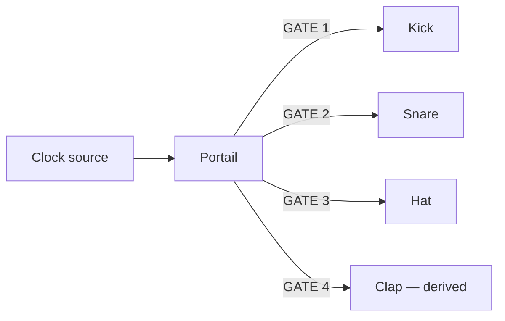

# Euclidean rhythms

**Goal:** a full percussion pattern generated inside Portail from a handful of
numbers, with parts that interlock rather than collide.

No sequencer needed — only a clock.

---

## Cabling

The clock is either Portail's internal generator or MIDI clock from a groovebox.
Both work; see [clocking a sequencer](clocking.md) for the external case.

---

## Global settings

For a self-contained patch:

| Setting | Value |
|---|---|
| Clock source | `Internal` |
| Clock state | `start` |
| Speed | `120` BPM |

For following a groovebox, set clock source to `External` instead and leave the
tempo alone.

---

## Settings

| Output | **Mode** | **Clock division** | **Gate length** | **Steps** | **Fills** | **Rotate** | **Level range** |
|---|---|---|---|---|---|---|---|
| GATE 1 | `Euclidean` | `1/16` | `5 ms` | `16` | `4` | `0` | `10 V` |
| GATE 2 | `Euclidean` | `1/16` | `5 ms` | `16` | `2` | `4` | `10 V` |
| GATE 3 | `Euclidean` | `1/16` | `5 ms` | `16` | `7` | `2` | `10 V` |

Press **update all parameters**, then **save parameters**.

---

## What you should hear

**GATE 1** — four hits per bar, evenly spaced. Four on the floor.

**GATE 2** — two hits per bar, displaced by four steps, so they land on the
backbeat.

**GATE 3** — seven hits spread across sixteen steps. Seven does not divide
sixteen, so the spacing is uneven and the pattern has a lopsided pull to it. That
unevenness is the entire point of Euclidean rhythm.

Together they lock into a groove that none of them contains individually.

---

## Why Rotate is the parameter that matters

**Steps** and **Fills** decide the *shape* of a rhythm. **Rotate** decides where it
starts, without changing the shape.

Two outputs with the same **Steps** and **Fills** and different **Rotate** values
produce the same rhythm, displaced — so they interlock instead of doubling.

Try it: set GATE 3's **Rotate** to `0` and it lands on top of the kick. Set it to
`2` and it weaves around it. Nothing else changed.

This is the parameter to move while the pattern is playing. Map it to a CC —
see below — and you have a live control that reshapes the relationship between
parts without changing any of them.

---

## Deriving a fourth part from the first three

The fourth output produces nothing of its own. It takes an existing pattern and
combines it with another using [Logic](../fx/logic.md):

| Output | **Mode** | **Clock division** | **Gate length** | **Steps** | **Fills** | **Rotate** | **Level range** |
|---|---|---|---|---|---|---|---|
| GATE 4 | `Euclidean` | `1/16` | `5 ms` | `16` | `7` | `2` | `10 V` |

| Slot | **Mode** | **Target** | **Function** | **Operand** |
|---|---|---|---|---|
| FX 1 | `Logic` | `GATE 4` | `AND` | `GATE 1` |

GATE 4 now fires only where the hat pattern and the kick pattern coincide — a
sparse accent that is rhythmically related to both and identical to neither.
Patch it to a clap.

Change **Function** to `XOR` and GATE 4 fires where exactly one of them hits,
filling the gaps instead of reinforcing the hits. Same two patterns, opposite
result.

---

## Making it breathe

Three additions, in order of how much difference they make:

**Loosen the timing.**

| Slot | **Mode** | **Target** | **Amount** |
|---|---|---|---|
| FX 2 | `Humanize` | `GATE 3` | `12%` |

The hats stop landing exactly on the grid. Keep it low — above about 30% it reads
as sloppy rather than human. Do not humanize the kick; the kick is what everyone
else is hearing the grid through.

**Vary the accents.**

| Slot | **Mode** | **Target** | **Level range** | **Mode** |
|---|---|---|---|---|
| FX 3 | `Random velocity` | `GATE 3` | `90` | `Replaced` |

This only reaches the jack if the destination is velocity-sensitive, which
Euclidean outputs are not by default — see
[Random velocity](../fx/random-vel.md). Patch GATE 3 into a module that
responds to trigger amplitude to hear it.

**Add ratchets.**

| Slot | **Mode** | **Target** | **Amount** | **Repeats** |
|---|---|---|---|---|
| FX 4 | `Repeats` | `GATE 2` | `2` | `3` |

Each snare hit becomes a three-stroke roll. See
[Repeats](../fx/repeats.md) — several of its details are unverified, so
expect to experiment.

---

## Playing it live

Map **Rotate** and **Fills** to CCs through the
[CC map](../concepts.md#7-the-cc-map-controls-parameters-from-cc):

| MIDI CC | Destination | Parameter | **Low note** | **High note** |
|---|---|---|---|---|
| 20 | GATE 3 | **Rotate** | `0` | `15` |
| 21 | GATE 3 | **Fills** | `1` | `12` |
| 22 | GATE 1 | **Fills** | `1` | `8` |

Three knobs now reshape the whole pattern while it runs. **Fills** on the kick is
the most dramatic — sweeping it from 1 to 8 takes you from a single downbeat to
eighth notes throughout.

Remember to **update all parameters** and then **save parameters** after setting
up mappings, or they vanish at power-off.

---

## Patterns worth knowing

| **Steps** | **Fills** | Name / feel |
|---|---|---|
| 16 | 4 | Four on the floor |
| 8 | 3 | Tresillo — the Latin 3+3+2 |
| 8 | 5 | Cinquillo |
| 16 | 5 | Sparse, syncopated |
| 16 | 7 | Busy, pulls against the beat |
| 16 | 9 | Denser, distinctly off-kilter |
| 12 | 5 | Rolling 12/8 |
| 5 | 2 | Odd-metre, repeats every 5 steps |

Any **Steps** value that is not a power of two makes the pattern cycle against a
4/4 grid, which is a good way to get long-evolving rhythms from one output.

---

## If it doesn't work

**Nothing fires.** The clock is not running. Check `clock state` is `start` in
the global settings, and if you are on `External`, that your source is actually
sending MIDI clock.

**Everything fires on every step.** **Fills** is equal to or greater than **Steps**.

**The patterns are all identical.** They have the same **Steps**, **Fills** and
**Rotate**. Change **Rotate** on one of them.

**The pattern runs at the wrong speed.** Check **Clock division**. `1/16` is sixteenths;
`1/4` is quarter notes and will sound four times slower.

**Hits are missed by the drum module.** Raise **Gate length** from 5 ms to 10 ms.

**Two outputs sound like one.** Their patterns coincide. Give one a different
**Rotate**, or use Logic with `XOR` to force them apart.
