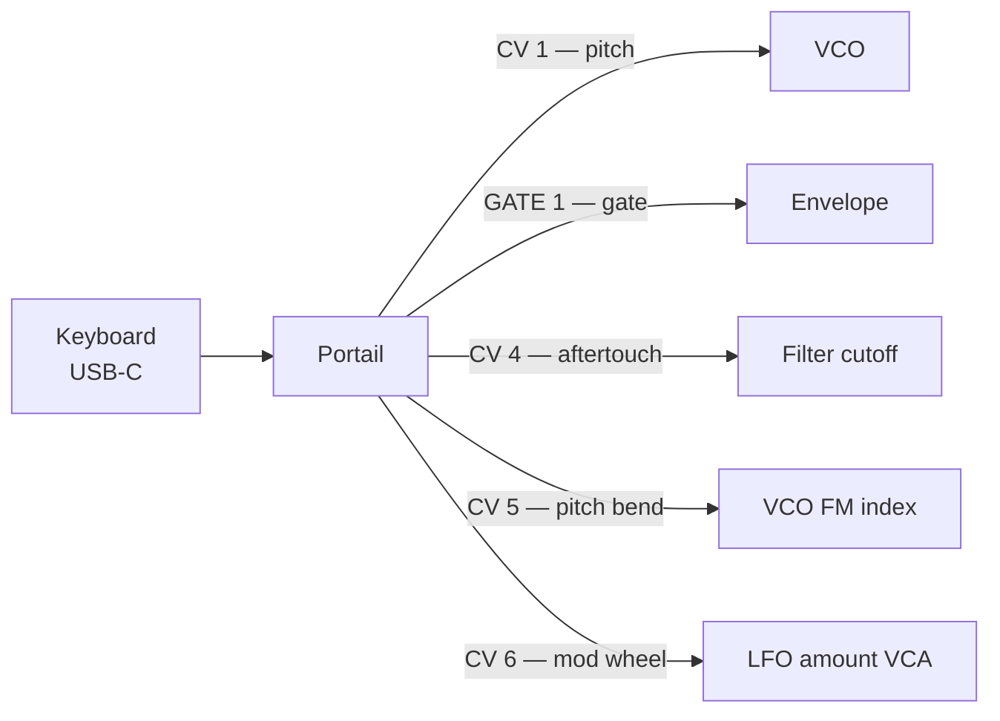

# Aftertouch and pitch bend as modulation

**Goal:** the expressive controls on your keyboard — pressure, the bend wheel,
the mod wheel — become patchable voltages that shape the sound while you play.

---

## Cabling

The voice is the standard pitch-and-gate pair. The three expression outputs are
extra, and each goes wherever you want it.

---

## Settings

**The voice:**

| Output | **Mode** | **Channel** | **Voice mode** | **Bend range** | **Vibrato rate** |
|---|---|---|---|---|---|
| CV 1 | `Note` | `ch 1` | `Mono last` | `+/-2` | `2.15 Hz` |

| Output | **Mode** | **Trigger source** | **Level range** | **Retrigger** |
|---|---|---|---|---|
| GATE 1 | `Gate` | `CV 1` | `10 V` | `On` |

**The expression outputs:**

| Output | **Mode** | **Channel** | **Level range** | **Slew** | Notes |
|---|---|---|---|---|---|
| CV 4 | `Aftertouch` | `ch 1` | `5 V` | `15` | Channel pressure |
| CV 5 | `Pitch bend` | `ch 1` | `+/-5 V` | `OFF` | Bend wheel, bipolar |
| CV 6 | `MIDI CC` | `ch 1` | `5 V` | `10` | **CC number** `1` — mod wheel |

Press **update all parameters**, then **save parameters**.

---

## Why each is set the way it is

**Aftertouch gets a **Slew** of 15.** Keybed pressure sensors are noisy — the raw
data jitters even when your hand is still. Without slew, a filter cutoff driven
by pressure buzzes. 15 is enough to smooth it without making the response feel
laggy.

**Pitch bend gets no **Slew**.** Bend is a 14-bit message and already smooth.
Filtering it only adds lag to a control that needs to feel immediate. And
`+/-5 V` is the point of using Pitch bend mode at all: the wheel springs back to centre,
so you get a bipolar control with a real zero — patch it to an FM index and the
wheel pushes the timbre in both directions from a known neutral.

**The mod wheel gets a moderate **Slew** of 10.** CC is 7-bit, so 128 steps
across 5 V is 39 mV per step — audible as stepping on a filter. A little slew
removes it.

Level range** is 5 V, not 10 V, on the two unipolar outputs.** A full 10 V swing into
a filter cutoff is usually more than the whole usable range of the filter, which
means all your control happens in the first third of the travel. 5 V gives finer
control where you actually play.

---

## What you should hear

Play and hold a note. Press harder into the key: the filter opens. Release the
pressure: it closes again.

Move the bend wheel up and down from centre: the FM index moves either side of
neutral. Let go and it springs back to no modulation.

Push the mod wheel: two things happen at once. CV 6 opens the LFO amount VCA
*and* — because **Vibrato rate** is set on CV 1 — the pitch starts to wobble. CC#1
controls vibrato depth on every Note output on the same channel, whether you
patch it or not.

---

## The vibrato interaction, which catches people

[Note](../modes/note.md) mode's **Vibrato rate** parameter sets the vibrato **rate**.
The **depth** always comes from CC#1, the mod wheel. There is no depth parameter.

Two consequences:

- Set **Vibrato rate** and hear nothing? The mod wheel is at zero. Push it up.
- Using CC#1 for something else, as CV 6 does here? Then it also modulates the
  pitch of every Note output on that channel. If you do not want that, set
  **Vibrato rate** to `OFF` on the Note rows, or move your general-purpose modulation to
  a different CC — 11, or anything in the 20–31 range that controllers rarely
  use by default.

---

## If your keyboard has no aftertouch

Most do not. Check before assuming the module is at fault: play a note, hold it,
press hard, and see whether CV 4 moves at all.

Substitutes, in order of usefulness:

- **An expression pedal**, usually CC 11. Set CV 4 to **Mode** `MIDI CC`, **CC number** `11`.
  Pedals are smoother than keybed pressure and need less **Slew**.
- **A second CC from a knob.** Any CC works.
- **A [Velocity](../modes/vel.md) output** — not continuous, but it gives you
  per-note dynamics that hold, which covers some of the same ground.

If your keyboard sends **polyphonic** aftertouch, use
[Poly aftertouch](../modes/poly-at.md) instead and set its **Trigger source** to a specific note —
that gives you pressure on one key that the rest of your playing does not
disturb.

---

## Going further: pressure controlling vibrato depth

Instead of using the mod wheel for vibrato, drive it from pressure. Patch CV 4
(aftertouch) into a VCA that controls an LFO's output level, and patch that LFO
into your oscillator's FM input.

You now have pressure-controlled vibrato that leaves the mod wheel free, and the
vibrato depth responds continuously to your hand rather than to a wheel you have
to reach for.

---

## If it doesn't work

**The aftertouch output never moves.** Your keyboard probably does not send it,
or has it switched off. See
[Troubleshooting](../troubleshooting.md#an-aftertouch-output-never-moves).

**The pitch bend output sits at one end instead of centring.** Check **Level range** is
`+/-5 V` and not a unipolar option. On a Gate output the negative half cannot be
produced at all — pitch bend belongs on a CV output.

**The filter jitters when I press.** Raise **Slew** on the Aftertouch output. 15 to 30 is
the usual range.

**The mod wheel makes the pitch wobble and I don't want it to.** Set **Vibrato rate** to
`OFF` on the Note row, or move your modulation off CC#1.

**Bend affects the pitch as well as the FM index.** That is **Bend range** on the
Note output doing its job. Set it to `+/-1` for minimal effect, and note there is
no "off" — the smallest setting still bends a semitone.
