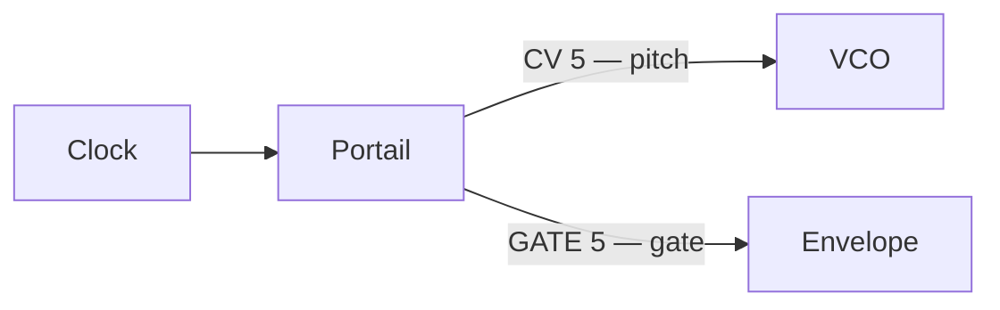

# Microtonal and scale playback

**Goal:** pitch that is constrained to a scale, or retuned away from twelve-tone
equal temperament altogether.

Two different jobs, easily confused:

- **[Scale](../fx/scale.md)** changes *which notes* play. It moves note
  numbers onto scale degrees. The tuning stays standard.
- **[Microtonal](../fx/microtonal.md)** changes *what the notes mean*. It
  replaces the note-number-to-voltage mapping, so the intervals themselves
  change.

Start with the first. The second has an important caveat.

---

## Part 1 — random notes that stay in key

The most useful thing Scale does is make a random source musical.

### Cabling

### Settings

| Output | **Mode** | **Trigger source** | **Clock division** | **Base note** | **Level range** | **Slew** |
|---|---|---|---|---|---|---|
| CV 5 | `Random` | `Clock` | `1/8` | `C2` | `+/-12` | `OFF` |

| Output | **Mode** | **Clock division** | **Gate length** | **Steps** | **Fills** | **Level range** |
|---|---|---|---|---|---|---|
| GATE 5 | `Euclidean` | `1/8` | `10 ms` | `8` | `5` | `10 V` |

| Slot | **Mode** | **Target** | **Scale** | **Root note** |
|---|---|---|---|---|
| FX 1 | `Scale` | `CV 5` | `pentatonic minor` | `A` |

Press **update all parameters**, then **save parameters**.

### What you should hear

A generative line: five notes per eight steps, each a random pitch within an
octave of C2, every one of them in A minor pentatonic. It never repeats and it
never plays a wrong note, because a pentatonic scale contains no notes that
clash.

Raise **Slew** on CV 5 to about `30` for a slurred version where the pitch slides
between notes.

### Changing the character

Swap **Scale** and hear the whole piece change:

| **Scale** | Character |
|---|---|
| `pentatonic minor` | Safe, never wrong |
| `pentatonic major` | Brighter, still safe |
| `minor` | More notes, more tension |
| `dorian` | Minor with a lifted sixth |
| `phrygian` | Dark, Spanish |
| `whole note` | Floating, no tonal centre |
| `major chord` | Broken-chord arpeggios, not a scale |
| **Octaves** | Only the root, in different octaves |

The last two are worth knowing about. `major chord` restricts the output to root,
third and fifth, so a random source becomes arpeggios. **Octaves** restricts it to
the root alone, which turns randomness into octave jumps — a good bass part.

### Order matters

If you add [Random note](../fx/random-note.md) or
[Accumulate](../fx/accumulate.md) as well, put **Scale in a higher slot
number**. Slots chain in numeric order, so Scale in FX 2 runs after Random note
in FX 1 and cleans up after it. Reverse them and you quantise first, then scatter
the result out of key.

[Random octave](../fx/random-oct.md) is the exception — it only changes
octaves, never pitch classes, so it is safe in either slot.

---

## Part 2 — microtonal tuning

### What ships on the module

**All eight microtonal tables ship as standard 12-tone equal temperament.**
Confirmed from the firmware. They are empty, user-customisable slots, not a menu
of exotic tunings — so out of the box, Microtonal on any table plays in standard
tuning and changes nothing.

That means using Microtonal musically is a two-step job: **put a tuning into a
slot**, then select it. Author the tuning in the editor's
**[Tuning tab](../editor.md#the-tuning-tab)** — enter twelve cents values, or
import a Scala `.scl` file — and send it to table 1–8. The write format is not
yet hardware-confirmed (the first send asks you to confirm) and a sent tuning
writes to working memory, so re-send it after powering the module on.

### Reading a table that has been customised

You only need this if a slot has been changed from the default. A factory slot is
standard tuning; measuring it just confirms even 83.3 mV steps.

1. Set CV 1 to **Mode** `Note`, **Channel** `ch 1`, everything else default.
2. Play `C3`, then `C#3`, `D3`, and so on up to `C4`, measuring the jack at each
   step. This is your **reference**: standard tuning gives twelve equal steps of
   83.3 mV, so C4 should read exactly 1.000 V above C3.
3. Add `FX 1: Microtonal, Target CV 1, Tuning table` set to the slot to read.
4. Repeat the measurement. Any step that differs from 83.3 mV is that pitch
   class's tuning. Convert with cents = millivolts × 1.2.
5. Repeat for the other slots you want to check.

A custom table lives in the module's own flash and cannot be read any other way —
so if a module carries interesting tunings, these measurements are worth writing
into [Appendix: scales and microtonal tables](../appendix-scales.md).

### Using a tuning, once a slot holds one

| Output | **Mode** | **Channel** | **Voice mode** |
|---|---|---|---|
| CV 1 | `Note` | `ch 1` | `Mono last` |

| Slot | **Mode** | **Target** | **Tuning table** |
|---|---|---|---|
| FX 1 | `Microtonal` | `CV 1` | `table 2` |

With `table 2` at its factory default this plays in standard tuning. Once the slot
holds a custom tuning, patch CV 1 to your oscillator and play normally: the
keyboard layout is unchanged — every key still produces a note — but the intervals
follow the table rather than the piano.

### Microtonal is always last

Whatever slot it occupies, Microtonal is applied at the end of the chain. That
follows from what it does: it is the final note-to-voltage step, so nothing can
run after it.

The practical consequence is convenient. You can combine Scale and Microtonal
without thinking about slot order — Scale picks the scale degrees, Microtonal
decides what pitch each degree produces:

| Slot | **Mode** | **Target** | Settings |
|---|---|---|---|
| FX 1 | `Scale` | `CV 1` | **Scale** `major`, **Root note** `C` |
| FX 2 | `Microtonal` | `CV 1` | **Tuning table** `table 3` |

A major scale, retuned by whatever `table 3` holds. If that slot were loaded with
a just-intonation tuning, the thirds would sound noticeably sweeter than the
equal-tempered version; at the factory default, the two FX combine to a plain
C-major quantiser.

---

## If it doesn't work

**Scale does nothing.** Its default **Scale** is `chromatic`, which passes every
note. Change it.

**Scale does nothing even after changing it.** The destination CV output is not
in a note-handling mode. Scale only works on `Note`, `Arpeggiator`, `Sequencer` and `Random` —
pointing it at an `LFO` or `MIDI CC` output has no effect.

**Notes are in key but the wrong key.** Check **Root note**. It is the key, not the
starting note of your part.

**Microtonal seems to do nothing.** Expected on a factory module — all eight
tables ship as standard tuning, so Microtonal only changes the pitch once a slot
has been loaded with a custom tuning. It is not broken; there is just nothing
non-standard in the slot yet.

**Everything is out of tune after adding Microtonal.** Then the slot you selected
has been customised away from 12-TET. Switch to a table still at the factory
default (any untouched slot), or remove the FX slot.

**The pitch is right but a fifth off.** Check nothing else in the chain is
transposing. [Transpose](../fx/transpose.md) and
[Accumulate](../fx/accumulate.md) both shift pitch and are easy to leave
pointed at the wrong destination.
