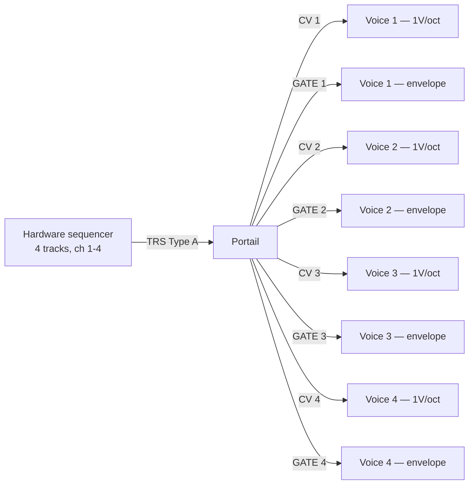

# Multitrack CV/gate pairs

**Goal:** four tracks on your hardware sequencer become four independent
monophonic voices in the rack, each with its own pitch and gate.

This is the patch that justifies a 16-output module in 5 HP.

---

## Cabling

Eight cables, four voices, and you still have CV 5–8 and GATE 5–8 free for
clock, modulation and drums.

---

## Settings

Set your sequencer's four tracks to MIDI channels 1, 2, 3 and 4.

**CV outputs** — one per track:

| Output | **Mode** | **Channel** | **Voice mode** | **Bend range** | `vibrato` | **Glide** | **Legato** | **Low note** | **High note** |
|---|---|---|---|---|---|---|---|---|---|
| CV 1 | `Note` | `ch 1` | `Mono last` | `+/-2` | `OFF` | `OFF` | `Off` | `C-2` | `G8` |
| CV 2 | `Note` | `ch 2` | `Mono last` | `+/-2` | `OFF` | `OFF` | `Off` | `C-2` | `G8` |
| CV 3 | `Note` | `ch 3` | `Mono last` | `+/-2` | `OFF` | `OFF` | `Off` | `C-2` | `G8` |
| CV 4 | `Note` | `ch 4` | `Mono last` | `+/-2` | `OFF` | `OFF` | `Off` | `C-2` | `G8` |

**Gate outputs** — each bound to its CV output, not to a channel:

| Output | **Mode** | **Trigger source** | **Level range** | **Velocity sensitive** | **Rise** | **Fall** | **Retrigger** |
|---|---|---|---|---|---|---|---|
| GATE 1 | `Gate` | `CV 1` | `10 V` | `Off` | `OFF` | `OFF` | `On` |
| GATE 2 | `Gate` | `CV 2` | `10 V` | `Off` | `OFF` | `OFF` | `On` |
| GATE 3 | `Gate` | `CV 3` | `10 V` | `Off` | `OFF` | `OFF` | `On` |
| GATE 4 | `Gate` | `CV 4` | `10 V` | `Off` | `OFF` | `OFF` | `On` |

**Setting Trigger source to the CV output rather than to a channel is the important
part.** When you do, the **Channel** parameter disappears from the Gate output,
because the channel is inherited. It means you only ever set the channel in one
place per voice — change CV 2 to channel 7 and GATE 2 follows automatically.

**Retrigger** `on` gives you a fresh gate on every note, which is what you want for
sequenced parts. Set it `Off` on any track where you want legato lines.

Press **update all parameters**, then **save parameters**.

---

## What you should hear

Four independent monophonic lines. Muting track 3 on the sequencer silences voice
3 and nothing else. Transposing track 1 moves only voice 1.

---

## Per-track character

Once it works, the per-voice parameters are where this gets interesting. All of
these are set on the CV output and cost nothing extra:

- **A bassline that slides.** CV 1: **Glide** `60`, **Legato** `on`. Overlapping notes
  slide, separated notes step.
- **A lead that bends further.** CV 2: **Bend range** `+/-12`. A full pitch bend moves
  an octave.
- **A part confined to a register.** CV 3: **Low note** `C2`, **High note** `C5`. Notes outside are
  ignored, which stops a stray octave in your sequence from sending an oscillator
  somewhere unusable.

And on the gate side:

- **A softer attack.** GATE 4: **Fall** `30 ms` removes the click when the gate
  drives a VCA directly.
- **Dynamics.** GATE 1: **Velocity sensitive** `on` — see
  [velocity to VCA](velocity-vca.md).

---

## Adding a fifth part without a fifth voice

You have four spare Gate outputs. Give one of them a drum:

- GATE 5: **Mode** `Trigger`, **Channel** `ch 5`, **Note** `all`, **Length** `5 ms`, **Level range** `10 V`

And a clock, from [clocking a sequencer](clocking.md):

- GATE 7: **Mode** `Clock`, **Trigger source** `clock`, **Clock division** `1/16`, **Length** `5 ms`
- GATE 8: **Mode** `Clock`, **Trigger source** `reset`, **Length** `5 ms`

That is four voices, a drum trigger, a clock and a reset from one 5 HP module,
with CV 5–8 still untouched.

---

## If it doesn't work

**All four voices play the same notes.** Your sequencer is sending every track on
one channel. Check its MIDI output settings — many devices default to a single
channel until you set them per track.

**A voice has pitch but no gate.** That Gate output's **Trigger source** is pointing at the
wrong CV output, or at `Note`. With **Trigger source** `note` and no channel set correctly,
it will not follow the voice.

**A gate fires but the pitch never changes.** The CV output is on a different
channel from the Gate output's source CV. Confirm the CV output's **Channel** matches
the sequencer track.

**Notes stick on.** Almost always a note-off that never arrived — see
[Troubleshooting → a note is stuck on](../troubleshooting.md#a-note-is-stuck-on).

**Two voices interfere.** Check that no two CV outputs are set to the same
`poly group`. In this patch every row should be `Mono last`; a stray poly group
setting makes two rows share notes.
