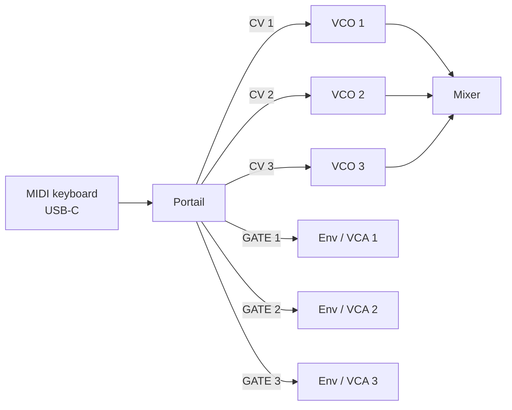

# Poly voice allocation from a keyboard

**Goal:** a MIDI keyboard plays three-note chords across three oscillators, each
with its own pitch, gate and envelope.

---

## Cabling

Three oscillators, three envelopes, three VCAs, one mixer. If you have fewer,
build two voices instead — the configuration is identical, just shorter.

---

## Settings

**The pitch outputs.** All three go into the same poly group. That is what makes
them a polyphonic allocator rather than three copies of the same note:

| Output | **Mode** | **Channel** | **Voice mode** | **Bend range** | **Glide** |
|---|---|---|---|---|---|
| CV 1 | `Note` | `ch 1` | `Poly group 1` | `+/-2` | `OFF` |
| CV 2 | `Note` | `ch 1` | `Poly group 1` | `+/-2` | `OFF` |
| CV 3 | `Note` | `ch 1` | `Poly group 1` | `+/-2` | `OFF` |

**The gates.** Each follows its own voice:

| Output | **Mode** | **Trigger source** | **Level range** | **Velocity sensitive** | **Retrigger** |
|---|---|---|---|---|---|
| GATE 1 | `Gate` | `CV 1` | `10 V` | `Off` | `On` |
| GATE 2 | `Gate` | `CV 2` | `10 V` | `Off` | `On` |
| GATE 3 | `Gate` | `CV 3` | `10 V` | `Off` | `On` |

**Trigger source** `CV n` is essential. A gate set to **Trigger source** `note` would fire on every note
in the chord, on all three outputs at once, and you would have three voices
playing in unison instead of a chord.

Press **update all parameters**, then **save parameters**.

---

## What you should hear

Play a three-note chord: three oscillators, three different pitches, all three
envelopes open. Release one key and one voice closes while the other two hold.

Play one note at a time and the voices are used in rotation — first note on CV 1,
second on CV 2, third on CV 3, fourth back to CV 1. That round-robin is
deliberate: it lets each voice's release finish before that voice is reused.

---

## Voice stealing

Play a fourth note while three are held. Portail has three voices, so one of the
held notes must give way.

**What it sounds like:** one of your held notes stops and is replaced by the new
one. The oscillator that was playing it jumps to the new pitch, and — with
**Retrigger** `on` — its envelope restarts, so you hear the change clearly.

`TODO(verify)`: **which voice gets stolen.** The round-robin allocator most
likely takes the oldest, but this is not documented anywhere and the editor's
source only names the groups. **Test:** with **Retrigger** `on`, hold C3, then E3, then
G3, then add B3 and listen for which pitch disappears. If C3 goes, it steals
oldest-first. Repeat several times to confirm it is consistent rather than taking
whichever voice was least recently allocated.

Knowing the answer matters for playing: if it steals oldest-first, holding a bass
note under a moving line will lose the bass note first, and you may want to give
the bass its own monophonic output on a separate channel instead of putting it in
the group.

**Reducing the impact:**

- Set **Retrigger** `off` on the gates. Stolen voices then change pitch without
  restarting the envelope, which is much less obtrusive — though it also stops
  repeated notes on the same voice from articulating.
- Add a fourth voice. CV 4 in `Poly group 1` with GATE 4 following it. Every CV
  output you add to the group is another note of polyphony, up to eight.

---

## Adding per-voice envelopes and dynamics

You have five Gate outputs left. Two ways to spend them:

**Velocity per voice** — each voice's own dynamics as a separate CV:

| Output | **Mode** | **Trigger source** | **Level range** |
|---|---|---|---|
| GATE 4 | `Velocity` | `CV 1` | `10 V` |
| GATE 5 | `Velocity` | `CV 2` | `10 V` |
| GATE 6 | `Velocity` | `CV 3` | `10 V` |

Patch each into that voice's VCA or filter cutoff.

**Or full envelopes**, saving three physical envelope modules:

| Output | **Mode** | **Trigger source** | **Mode** | **Attack** | **Decay** | **Sustain** | **Release** |
|---|---|---|---|---|---|---|---|
| GATE 4 | `Envelope` | `CV 1` | `ADSR` | step 20 | step 60 | `70` | step 70 |
| GATE 5 | `Envelope` | `CV 2` | `ADSR` | step 20 | step 60 | `70` | step 70 |
| GATE 6 | `Envelope` | `CV 3` | `ADSR` | step 20 | step 60 | `70` | step 70 |

Envelope times are an exponential 128-step table — see
[Envelope](../modes/env.md#the-time-scale) for what the step numbers mean in
milliseconds.

---

## A second independent part

There are four poly groups. Put a two-voice pad on channel 2 alongside the
three-voice lead on channel 1:

| Output | **Mode** | **Channel** | **Voice mode** |
|---|---|---|---|
| CV 5 | `Note` | `ch 2` | `Poly group 2` |
| CV 6 | `Note` | `ch 2` | `Poly group 2` |

With gates on GATE 7 and GATE 8 sourced from CV 5 and CV 6. The two parts do not
interact at all.

---

## If it doesn't work

**All three oscillators play the same pitch.** The three CV outputs are not all
in the same poly group — check each output's **Voice mode**. If any is set to a `mono`
option it will take every note independently.

**Only one voice ever plays.** The other two rows are probably still `OFF`, or
are on a different channel.

**All three gates fire on every note.** The gates are set to **Trigger source** `note`
instead of **Trigger source** `CV 1`, `CV 2`, `CV 3`.

**Chords play but single notes jump between oscillators.** That is correct
behaviour — round-robin allocation. If you want repeated notes to stay on one
voice, you want a monophonic output, not a poly group.

**Notes stick on after releasing keys.** See
[Troubleshooting → a note is stuck on](../troubleshooting.md#a-note-is-stuck-on).
