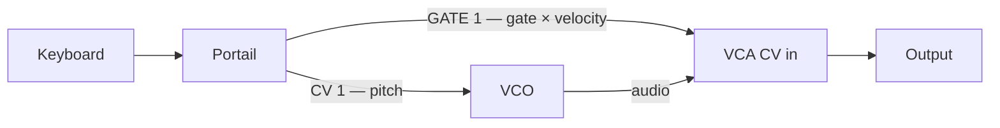

# Velocity to VCA

**Goal:** how hard you play controls how loud the note is — with one cable, not
three modules.

---

## The short version

Set a Gate output to `Gate` mode with **Velocity sensitive** `on`, and patch it straight into a
VCA's CV input.

That single cable carries both the timing (the gate is high while the note
sounds) and the dynamics (its height is proportional to velocity). No envelope,
no separate velocity CV, no VCA offset to set up.

---

## Cabling

---

## Settings

| Output | **Mode** | **Channel** | **Voice mode** |
|---|---|---|---|
| CV 1 | `Note` | `ch 1` | `Mono last` |

| Output | **Mode** | **Trigger source** | **Level range** | **Velocity sensitive** | **Rise** | **Fall** | **Retrigger** |
|---|---|---|---|---|---|---|---|
| GATE 1 | `Gate` | `CV 1` | `10 V` | `On` | `OFF` | `5 ms` | `On` |

The **Fall** of 5 ms is the one thing that is not obvious. A gate driving a VCA
directly produces an audible click when it snaps to zero; a few milliseconds of
fall removes it without making the note sound soft.

Add a little **Rise** too — 5 to 15 ms — if the note onset clicks.

Press **update all parameters**, then **save parameters**.

---

## What you should hear

Play softly and the note is quiet. Play hard and it is loud. Hold the key and the
level stays constant until you release.

The scaling is linear between 0 V and **Level range**: velocity 127 gives 10 V, velocity
64 gives about 5 V, velocity 1 gives almost nothing.

---

## When "almost nothing" is a problem

Very soft notes produce very little voltage, and below some level a VCA passes
nothing at all. If your quiet notes are disappearing entirely rather than being
quiet, you want a floor under the velocity scaling.

[Gate](../modes/gate.md) mode has no minimum-level control. [Trigger](../modes/trig.md)
does — its **Level min** parameter:

| Output | **Mode** | **Trigger source** | `Note` | **Length** | **Velocity sensitive** | **Level min** | **Level range** |
|---|---|---|---|---|---|---|---|
| GATE 1 | `Trigger` | `CV 1` | `all` | `Latch` | `On` | `2 V` | `10 V` |

**Length** `latch` makes Trigger behave like a gate — high while the note is held —
while giving you the **Level min** control that Gate lacks. Velocity now scales
between 2 V and 10 V, so the softest note still opens the VCA.

This latch-plus-minimum combination is the most useful thing Trigger does that Gate
cannot, and neither the official manual nor the mode's name suggests it.

---

## The alternative: velocity as its own CV

If you want dynamics to control something *other* than level — filter cutoff,
say — you need velocity as a separate signal:

| Output | **Mode** | **Trigger source** | **Level range** |
|---|---|---|---|
| GATE 2 | `Velocity` | `CV 1` | `10 V` |

[Velocity](../modes/vel.md) outputs a level that is set at note-on and **holds until
the next note**. It does not fall at note-off, so it is not a gate — patch it
into a filter's cutoff CV and the brightness follows your playing while GATE 1
handles the timing.

Two cables instead of one, but the two jobs are now separate and you can scale
them independently.

---

## Velocity to brightness as well as level

Both at once, which is what an acoustic instrument does:

| Output | **Mode** | **Trigger source** | **Level range** | **Velocity sensitive** |
|---|---|---|---|---|
| GATE 1 | `Gate` | `CV 1` | `10 V` | `On` |
| GATE 2 | `Velocity` | `CV 1` | `5 V` | — |

GATE 1 into the VCA, GATE 2 into the filter cutoff. Hard notes are louder *and*
brighter. Use a lower **Level range** on the velocity output — 3 V to 5 V — because a
full 10 V swing on a filter cutoff is usually far too much.

---

## If it doesn't work

**Every note is the same volume.** **Velocity sensitive** is `Off`, or your keyboard is
sending a fixed velocity. Many controllers have a velocity curve setting with a
"fixed" option — check that before changing anything on Portail.

**Every note is full volume regardless.** The VCA may have its own level offset
turned up, so it is already open before the gate arrives. Turn the VCA's initial
gain to zero.

**Soft notes disappear completely.** Use the Trigger-with-**Level min** version above.

**There is a click at the start or end of each note.** Add **Rise** and **Fall** of
5–15 ms.

**The level jumps around on held notes.** You may be sending aftertouch that the
VCA is also receiving, or **Velocity sensitive** is interacting with a
[Random velocity](../fx/random-vel.md) FX slot you have left pointed at this
output. Check the FX tab.
